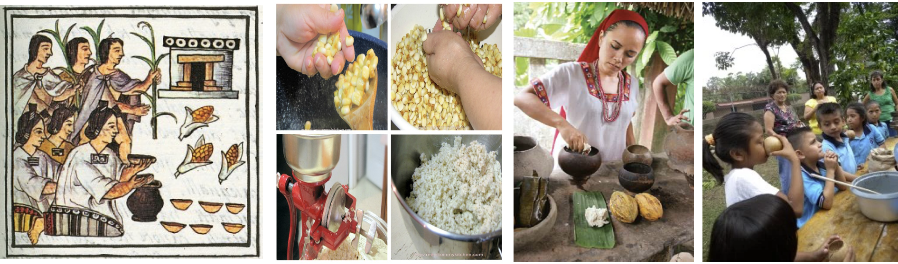
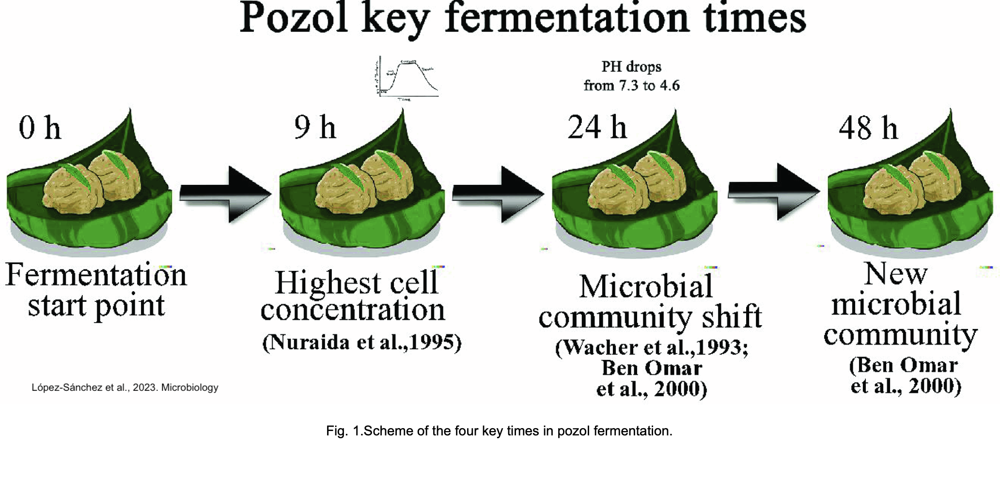

{fig-align="center"}

**El pozol** es un alimento ácido, fermentado a partir de maíz nixtamalizado, de importancia económica y cultural, se consume desde tiempos prehispánicos y se ha estudiado desde los años 50s.

Algunos puntos importantes que conocemos son:

-   No se inocula y al final de su fermentación tiene alta diversidad microbiana.

-   Es muy nutritivo, tiene un alto contenido de aminoácidos esenciales.

-   Es considerado como **prebiótico,** contiene fibras solubles y microorganismos benéficos para la salud intestinal humana**.**

------------------------------------------------------------------------

🧬🔊🦠 Imaginemos que se quiere impulsar la producción de esta bebida y para ello necesitan saber todo acerca de su naturaleza microbiana.

Una importante industria alimenticia los contacta como **expertos en ecología microbiana** y les pide ayuda para descubrir los siguientes puntos:

-   ¿Qué actores microbianos están presentes durante el proceso de fermentación?

-   ¿Qué funciones metabólicas están ocurriendo?

-   ¿Cambia la comunidad microbiana a lo largo del proceso?

-   ¿Cómo ocurre la bioconversión del maíz durante la fermentación, quién participa y cómo lo hace?

La empresa secuenció cuatro puntos de fermentación de muestras que se obtuvieron en un mercado de Campeche. Las muestras se secuenciaron con Illumina NextSeq500 con lecturas pareadas de 75 pb. Los datos están públicos bajo el Bioproject: [PRJNA648868](https://www.ebi.ac.uk/ena/browser/view/PRJNA648868)

------------------------------------------------------------------------

**El artículo**: López-Sánchez et al., 2023. Analysing the dynamics of the bacterial community in pozol, a Mexican fermented corn dough. [10.1099/mic.0.001355](https://www.microbiologyresearch.org/content/journal/micro/10.1099/mic.0.001355)
