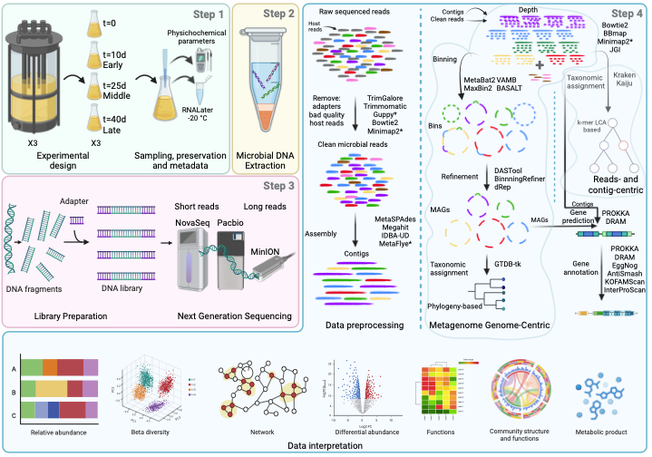

## 01. Espacio de trabajo

Durante cualquier proyecto bioinformático es importante tener orden del directorio de trabajo y los procesos que se ejecutan.

Una buena práctica es crear un directorio principal del proyecto que contenga subdirectorios de trabajo, la estructura puede ser la siguiente:

**`data`** Directorio donde se almacenan los datos que sirven como\
entrada inicial para comenzar el proyecto.

**`results`** Directorio en el que se almacenan los resultados obtenidos\
en cada paso del análisis.

**`scripts`** Directorio en el que se almacenan los scripts generados en cada paso del análisis.

**`outs`** Directorio en el se direccionan las salidas del stdout a un archivo log de cada proceso.

**`README.md`** Archivo README principal en el que se explica el objetivo\
del proyecto, el flujo de trabajo, los requistos de\
ejecución, estructura del repositorio, los resultados obtenidos y sus conclusiones.

------------------------------------------------------------------------

Conozcamos el directorio en el que estamos situados

copia el directorio completo

``` bash
cp -r /home/dianao/reads2mags_pozol .
```

``` bash
pwd
```

Vamos a acceder al directorio de este proyecto

``` bash
cd reads2mags_pozol
```

Y ahora revisemos la estructura

``` bash
ls
```

Entremos al directorio `data` para ver lo que contiene

``` bash
cd data/
ls -lh
```

¿Cuántas muestra hay?

------------------------------------------------------------------------

------------------------------------------------------------------------

## 02. Vamos a organizarnos

::: callout-tip
## Reglas del juego

-   **En este tutorial haremos el ejemplo corriendo la muestra del tiempo 0h.**

-   **Se formaran 6 equipos (2 correspondientes a los tiempos 0, 24 y 48 horas).**

-   **Se reunirán y en equipo discutirán y presentarán sus resultados cuando se indique en el tutorial.**
:::

------------------------------------------------------------------------

------------------------------------------------------------------------

## 03. Advertencias

<p align="justify">

<FONT COLOR="black">La presente práctica sólo es una representación del flujo de trabajo para el an álisis metagenómico, sin embargo, **no sustituye los manuales** de cada programa y el flujo puede variar dependiendo del tipo de datos y pregunta de investigación, de hecho para fines del taller, con frecuencia se utilizan las lineas de comando más simples para eficientar tiempo y recursos, tómalo en cuenta.</FONT>

</p>

Cada programa tiene una ayuda y un manual de usuario, es **importante** revisarlo y conocer cada parámetro que se ejecute. En terminal se puede consultar el manual con el comando `man` y también se puede consultar la ayuda con `-h` o `--help`, por ejemplo `fastqc -h`.

------------------------------------------------------------------------

------------------------------------------------------------------------

::: callout-important
🧠 Para tenerlo presente

<FONT COLOR="purple">En bioinformática cualquier línea de comandos generará un resultado, de ahí a que esos resultados sean correctos puede haber una gran diferencia.</FONT>

En cada paso:

-   **Detente a revisar la información de cada programa, lee el manual y la ayuda**

-   **Elige los parámetros que mejor se adapten a tus datos.**

-   **Analiza las salidas de cada proceso y los resultados.**

-   **Haz varias pruebas, usa controles (positivo y negativo).**

-   **Visita foros de ayuda, complementa con IA.**

-   **Toma decisiones informadas y con argumentos sólidos.**

-   **Disfruta el proceso.**
:::

## 04. ¿Cómo abordar Proyecto Metagenómico?

En los proyectos metagenómicos el diseño experimental y el procesamiento de los datos es muy importante. El procesamiento puede abordarse de dos maneras diferentes, durante este taller veremos la forma más básica y durante la segunda parte veremos la forma avanzada.


