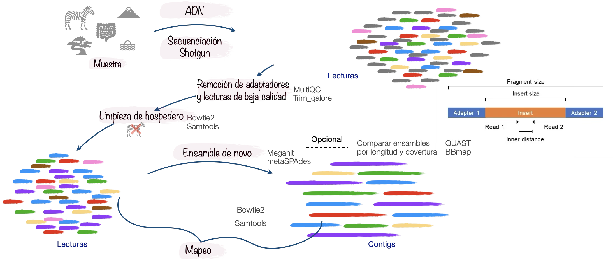
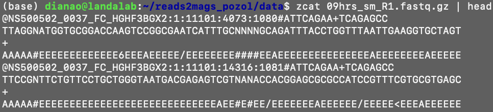
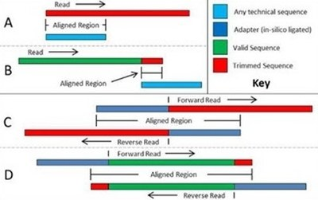
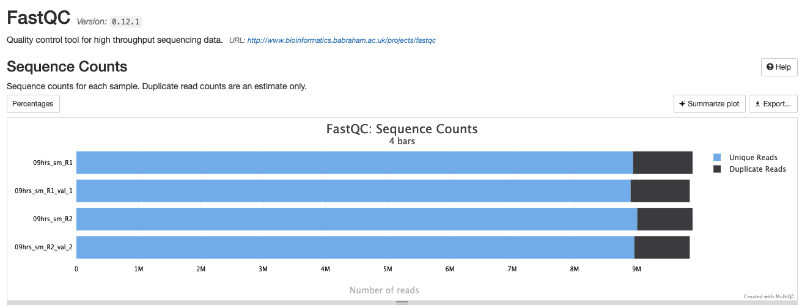

## Recordatorio sobre las lecturas



Entremos al directorio `data`

``` bash
cd data/
```

::: callout-note
## ¿Pero, qué es un FASTQ?

Un archivo **FASTQ** contiene secuencias de ADN/ARN obtenidas mediante secuenciación masiva y la **calidad de cada base**. Cada lectura ocupa 4 líneas:

1.  Identificador de la lectura.

2.  Secuencia de nucleótidos.

3.  Separador (`+`).

4.  Calidad de cada base codificada en caracteres.
:::



Veamos cuántas lecturas tiene la muestra del tiempo 0 hrs:

``` bash
zcat 0hrs_sm_R1.fastq.gz | awk 'END {print NR/4}'
zcat 0hrs_sm_R2.fastq.gz | awk 'END {print NR/4}'
```

:::: callout-warning
## Preguntas

1\) ¿Cuántas muestras hay?

2\) ¿Cuántas lecturas tiene cada muestra?

::: {.callout-tip collapse="true"}
Opción para ver todas de un jalón

``` bash
printf "Muestra\tR1\tR2\tTotal\n"
for r1 in *_R1.fastq.gz; do
    sample=$(basename "$r1" _R1.fastq.gz)
    r2="${sample}_R2.fastq.gz"

    n1=$(zcat "$r1" | awk 'END {print NR/4}')
    n2=$(zcat "$r2" | awk 'END {print NR/4}')
    total=$((n1 + n2))

    printf "%s\t%s\t%s\t%s\n" "$sample" "$n1" "$n2" "$total"
done
```

Respuesta:

|          |         |         |          |
|----------|---------|---------|----------|
| Muestra  | R1      | R2      | Total    |
| 0hrs_sm  | 1117454 | 1117454 | 2234908  |
| 24hrs_sm | 9888834 | 9888834 | 19777668 |
| 48hrs_sm | 7260747 | 7260747 | 14521494 |
| 9hrs_sm  | 9899280 | 9899280 | 19798560 |
:::
::::

::: callout-warning
## Piensen en equipo (3 min)

1.  La muestra de 0 hrs tiene \~2.2 M de lecturas; las demás, \~15–20 M. ¿Qué hipótesis biológicas explicarían que el tiempo 0 tenga tan pocas? (pista: ¿cuánta biomasa microbiana hay antes de que arranque la fermentación?)
2.  ¿Qué problema trae esa diferencia de profundidad al comparar muestras más adelante (ensamble, binning, abundancias)? ¿Cómo lo compensarían?
3.  R1 y R2 tienen exactamente el mismo número de lecturas. ¿Por qué? ¿Qué significaría si no coincidieran?
:::

------------------------------------------------------------------------

------------------------------------------------------------------------

## 01. Evaluación de calidad con FastQC

Para evaluar la calidad de nuestros archivos FASTQ, utilizaremos FastQC

[FastQC](https://github.com/s-andrews/FastQC) es un programa que nos permite visualizar la calidad de nuestras lecturas, permitiendo detectar alguna anomalía en las secuencias antes de hacer cualquier análisis:

-   Lecturas de baja calidad en los extremos

-   Contaminación por adaptadores

-   Sesgos en la secuenciación

-   Presencia de secuencias duplicadas

::: callout-important
## Directorio Principal

Regresemos a nuestro directorio principal:

``` bash
cd
cd reads2mags_pozol
```
:::

Vamos a crear el directorio que albergará los resultados de fastqc y multiqc

``` bash
mkdir -p results/01.fastqc/0h
```

Revisaremos la calidad con fastqc

``` bash
fastqc data/0hrs_sm_R* -o results/01.fastqc/0h
```

::: callout-warning
## Antes de "arreglar" nada

-   ¿En qué extremo de la lectura cae la calidad y por qué es esperable en Illumina?
-   FastQC suele marcar en rojo el "per base sequence content" en las primeras bases. En metagenómica esto es común por el cebado aleatorio/tagmentación: ¿lo tratarían como un problema real o no? ¿Por qué?
:::

------------------------------------------------------------------------

------------------------------------------------------------------------

## 02. Eliminación de adaptadores y lecturas de baja calidad.

{fig-align="center"}

Usaremos [**TrimGalore**](https://github.com/FelixKrueger/TrimGalore) que nos permite eliminar lecturas de baja calidad, adaptadores, duplicados, etc. Existen otros programas para limpiar las lecturas como [**Trimmomatic**](https://github.com/usadellab/Trimmomatic), Fastp, etc.

Creamos el directorio de resultados

``` bash
mkdir -p results/02.trimgalore/0h
```

Ahora si vamos a filtrar las lecturas

Antes de ejecutarlo veamos la ayuda de trim_galore

``` bash
trim_galore --help
```

``` bash
trim_galore --fastqc -j 4 --paired data/0hrs_sm_R1.fastq.gz data/0hrs_sm_R2.fastq.gz -o results/02.trimgalore/0h
```

## 03. Revisemos la calidad de las lecturas antes y después de limpiar

[MultiQC](https://github.com/MultiQC/MultiQC) toma los resultados de FastQC y los resume en un único informe que nos permite:

-   Revisar la calidad de todas las muestras a la vez.

-   Comparar rápidamente cuál muestra tiene peor calidad.

-   Facilitar la interpretación sin tener que abrir muchos HTMLs.

-   Identificar como están las lecturas y los posibles problemas para planear futuros análisis si son necesarios.

Revisemos la calidad con multiqc

``` bash
multiqc results/01.fastqc/0h/ results/02.trimgalore/0h/ -o results/02.trimgalore/0h/
```

Descarguemos el resultado de multiqc para evaluarlo

``` bash
# Descubramos cual es la ruta absoluta del resultado de multiqc
realpath results/02.trimgalore/0h/multiqc_report.html

#en mi caso es:
# /home/dianao/reads2mags_pozol/results/02.trimgalore/0h/multiqc_report.html

# Ahora vamos a una terminal de nuestra computadora para poder descargar el archivo
scp dianao@[ip del servidor]:/home/dianao/reads2mags_pozol/results/02.trimgalore/0h/multiqc_report.html
```



::: callout-warning
## Reúnanse en equipo y resuelvan estas preguntas (10 min)

¿Cambió la calidad?

¿Cuántas lecturas había y cuántas quedaron después del filtro?

TrimGalore quitó adaptadores sin que le dijeras cuál. ¿Cómo lo supo? (autodetección examinando las primeras lecturas).

¿Por qué `--paired`? Si una lectura se recorta mucho y su pareja no, ¿qué le pasa al par? (mantiene sincronía, descarta huérfanos).
:::

------------------------------------------------------------------------

------------------------------------------------------------------------

## 04. Nota sobre la remoción del genoma del maíz

Como las muestras del pozol tienen DNA de maíz es necesario eliminar las lecturas de éste para quedarnos con las secuencias pertenecientes al microbioma. Para hacer este proceso se necesita hacer un mapeo global, existen diferentes herramientas que nos permiten realizarlo, como bwa, bowtie2, bbmap o minimap (este último para lecturas largas).

Cómo es un proceso largo, nos dimos a la tarea de ejecutarlo y las lecturas que estaremos trabajando ya no contienen el genoma del maiz. Este es el script que usamos para obtenerlas.

::: {.callout-tip collapse="true"}
## Script de remoción de hospedero

``` bash
#!/bin/bash
#Script que corre bwa para mapear lecturas metagenomas al genoma del hospedero, en este caso maiz utilizando BWA y Samtools


# 01. Utilizamos BWA para crear un índice basado en el genoma de referencia del maíz
bwa index -p maize_index -a bwtsw data/zeamays.fa
# 23 min

# 02. Ya que creamos el índice haremos un alineamiento de las lecturas del pozol para mapear las correspondientes al genoma del maíz

bwa mem -t 10 maize_index data/0hrs_R1.fastq.gz \
 data/0hrs_R2.fastq.gz \
 | samtools view -Sb - | samtools sort -o data/mapping.sorted.bam
 
echo "INFO: Pipeline finalizado. El resultado está en mapping.sorted.bam"

#Ahora vamos a extraer las lecturas que no corresponden al genoma del maíz (flag77) y (flag 141)

#Primero en R1
samtools view -f 77 mapping.sorted.bam | \
awk '{print "@"$1"\n"$10"\n+\n"$11}' > data/0hrs_sm_R1.fastq
# Ahora en R2
samtools view -f 141 mapping.sorted.bam | \
awk '{print "@"$1"\n"$10"\n+\n"$11}' > data/0hrs_sm_R2.fastq
```
:::

::: callout-note
## Reflexionemos

-   El hospedero aquí es el maíz. ¿Cuál sería en un metagenoma de intestino humano? ¿Y en uno de suelo?

-   ¿Qué le pasaría a tu ensamble y a tus MAGs si NO quitáramos el maíz?

-   ¿Conviene remover hospedero antes o después del trimming?
:::
