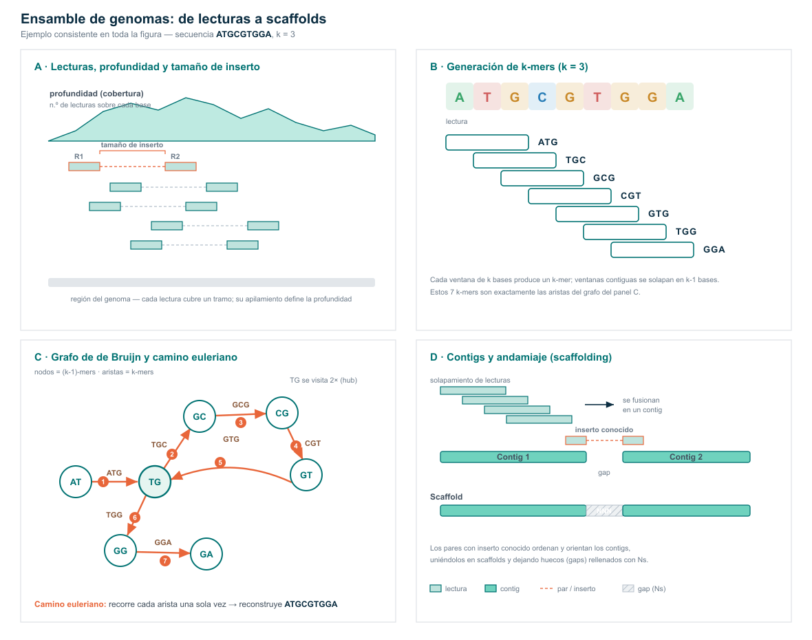
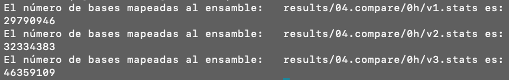
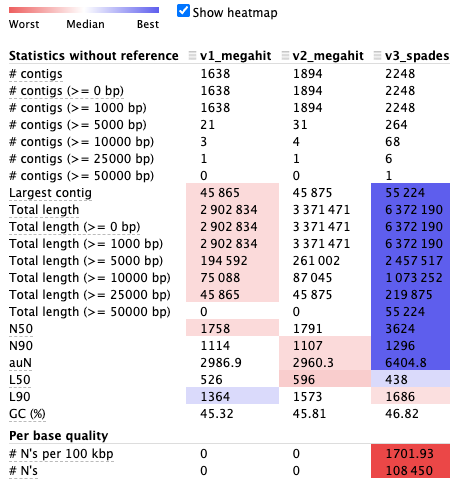

# 01. Ensamble de las secuencias

Una vez teniendo las secuencias limpias ya podemos realizar el ensamble.\
Ensamblaremos con [**MetaSPAdes**](https://github.com/ablab/spades) y [**Megahit**](https://github.com/voutcn/megahit), después compararemos ambos ensambles basándonos en longitudes de los contigs con QUAST y el porcentaje de lecturas que dan lugar al ensamble, esto con bbmap de [**bbtools**](https://jgi.doe.gov/data-and-tools/software-tools/bbtools/).

Los ensambladores de metagenomas que actualmente se utilizan funcionan mediante la generación de gráficos de Bruijn:



Manos a la obra, vamos a ensamblar diferentes versiones de ensambles.

Vamos a crear el directorio de resultados

``` bash
mkdir -p results/03.ensambles/0h
```

### 01.1 Versión 1 de ensamble

1.  Ahora si, vamos a ensamblar las lecturas usando el tamaño e incrementos de k-mers que el programa tiene por defecto, esta será nuestra primer versión.

Vamos a generar un script que corra esta versión:

``` bash
#!/usr/bin/bash
# Nombre y fecha
# Script que corre  version 1 de ensamble con megahit

# v01
nohup megahit -t 4 --min-contig-len 1000 \
 --out-prefix v1_megahit \
 -1 results/02.trimgalore/0h/0hrs_sm_R1_val_1.fq.gz \
 -2 results/02.trimgalore/0h/0hrs_sm_R2_val_2.fq.gz \
 -o results/03.ensambles/0h/v1 > outs/03.megahit_0hv1.out &
```

::: callout-important
## OJO

Estamos utilizando la opción `--min-contig-len 1000` para efectos del curso y el tipo de datos que tenemos, sin embargo, esta opción podría estar demasiado laxa, hay estudios que han demostrado que el uso de contigs de longitud menor a 2000 pb puede producir malas agrupaciones de genomas (MAGs) .
:::

------------------------------------------------------------------------

::: callout-warning
## Precaución

Las siguientes dos versiones de ensamble tardan todavía más tiempo que la primer versión, así que nos dimos a la tarea de correrlas y los resultados se encuentran en el directorio de resultados correspondiente. Exploremoslos!!!
:::

El flujo y código para correr las otras dos versiones se despliega a continuación, recuerda que **NO es para ejecutarse**, pero te lo dejamos como ejemplo para que lo puedas replicar más tarde en los ejercicios.

:::: {.callout-tip collapse="true"}
## Versiones 2 y 3 de ensambles

------------------------------------------------------------------------

### 01.2 Versión 2 de ensamble

2.  Para la segunda versión con megahit, cambiaremos el tamaño y pasos de k-mers. Aunque no lo vamos a ejecutar, te dejamos la linea de código que se usa para esta versión. Vamos a revisarla:

``` {.bash collapse="true"}
# v02
megahit -t 4 --min-contig-len 1000 \
 --presets meta-sensitive --out-prefix v2_megahit \
 -1 results/02.trimgalore/0h/0hrs_sm_R1_val_1.fq.gz \
 -2 results/02.trimgalore/0h/0hrs_sm_R2_val_2.fq.gz \
 -o results/03.ensambles/0h/v2 
```

------------------------------------------------------------------------

### 01.3 Versión 3 de ensamble

La tercera versión de ensamble es mediante otro ensamblador llamado metaSPAdes, en esta versión usaremos los parámetros por defecto para poder hacer una comparación justa con la primer versión de Megahit.

``` bash
#El directorio para los resultados
mkdir -p results/03.ensambles/0h/v3
# La linea de comando para ejecutarla
nohup metaspades.py -t 6 \
 -1 results/02.trimgalore/0h/0hrs_sm_R1_val_1.fq.gz \
 -2 results/02.trimgalore/0h/0hrs_sm_R2_val_2.fq.gz \
 -o results/03.ensambles/0h/v3 > outs/03.2.metaspades.nohup &
```

Remover contigs que sean menores a 1000 pb para que sea comparable con los ensambles de megahit, puede ser con seqkit

``` bash
seqkit seq -m 1000 results/03.ensambles/0h/v3/scaffolds.fasta > results/03.ensambles/0h/v3.spades.fasta
```

Revisemos el contenido del directorio `results/03.ensambles/`

``` bash
ls results/03.ensambles/
```

Notarás que el ensamble filtrado de spades ya vive en este directorio

------------------------------------------------------------------------

::: callout-note
## Una buena práctica

Cómo todo en la ciencia, la ejecución de proyectos bioinformáticos requieren de buenas prácticas, una de tantas es eliminar archivos intermedios que dejan de ser útiles después de la exploración.

En el ejemplo de los ensambles, los archivos intermedios suelen ser muy pesados y esto ocasiona saturación del servidor, así que vamos a limpiar nuestro directorio de ensambles.

``` bash
 # cambiamos de lugar los ensambles de megahit y los renombramos
 cd results/03.ensambles/0h/
 mv v1/v1_megahit.contigs.fa v1_megahit.fasta
 mv v2/v2_megahit.contigs.fa v2_megahit.fasta
 
 # ya que tenemos los resultados en el directorio results/03.ensambles, 
 #eliminamos los directorios que contienen todos los archivos
 #intermedios de cada versión de ensamble 
 rm -r v1/ v2/ v3/
 
 # y regresamos al directorio principal
 cd && cd reads2mags_pozol
```
:::
::::

------------------------------------------------------------------------

# La diversión ha llegado:

::: callout-tip
## Ejercicios

**Ahora a te toca a tí**

Les toca ensamblar la muestra del tiempo de fermentación que les tocó. En equipo discutan y armen las lineas de comando para correr dos versiones de sólo de megahit. **Sólo un miembro del equipo corra el script** mientras los demás le ayudan a dictar las lineas de comandos.

Tiempo 30 min
:::

------------------------------------------------------------------------

# 02. Comparación de ensambles

## 02.1 Mapeo de las lecturas

Se usara [**bbtools**](https://jgi.doe.gov/data-and-tools/software-tools/bbtools/) para mapear las secuencias ensambladas.

Vamos a crear el directorio que albergará los resultados de profundidad

``` bash
mkdir -p results/04.compare/0h/
```

Vamos a mapear todos los ensambles que obtuvimos a las lecturas limpias,

hagamos un script para esto:

``` bash
nano scripts/04.mapeo_comparacion.sh
```

``` bash
#!/usr/bin/bash
#Script que corre BBmap para mapear y obtener el numero de lecturas mapeadas a cada version de ensamble

# version 1
bbmap.sh ref=results/03.ensambles/0h/v1_megahit.fasta in=results/02.trimgalore/0h/0hrs_sm_R1_val_1.fq.gz in2=results/02.trimgalore/0h/0hrs_sm_R2_val_2.fq.gz nodisk=t threads=10 scafstats=results/04.compare/0h/v1.stats

# version 2
bbmap.sh ref=results/03.ensambles/0h/v2_megahit.fasta in=results/02.trimgalore/0h/0hrs_sm_R1_val_1.fq.gz in2=results/02.trimgalore/0h/0hrs_sm_R2_val_2.fq.gz nodisk=t threads=10 scafstats=results/04.compare/0h/v2.stats

# version 3
bbmap.sh ref=results/03.ensambles/0h/v3_spades.fasta in=results/02.trimgalore/0h/0hrs_sm_R1_val_1.fq.gz in2=results/02.trimgalore/0h/0hrs_sm_R2_val_2.fq.gz nodisk=t threads=10 scafstats=results/04.compare/0h/v3.stats
```

Activamos el ambiente

``` bash
conda activate bbmap_env
```

Y lo ejecutamos asi:

``` bash
nohup bash scripts/04.profundidad.sh > outs/04.bbmap.out &
```

Vamos a explorar cuantas bases se mapearon en cada uno de los ensambles

``` bash
for file in $(ls results/04.compare/0h/*.stats); do 
  echo "El número de bases mapeadas al ensamble:  " $file "es: "
  cut -f9 $file | grep -v assignedBases | awk '{sum += $1;}END{print sum;}'
done
```



Bien, ahora ya sabemos que ensamble se formó con una mayor cantidad de lecturas, sin embargo, ahora nos falta conocer que ensamble tiene una mayor longitud de contigs.

::: callout-caution
## Preguntas

¿Qué porcentaje de las lecturas se mapearon en todos los casos? (revisa el archivo `outs/04.bbmap.out`)

¿Qué pasó con las lecturas que no mapearon al ensamble?
:::

## 02.2 Longitud de los contigs

Por último, se utilizará [Quast](https://github.com/ablab/quast) para revisar la longitud que tienen los contigs de cada ensamble.

``` bash
quast.py results/03.ensambles/0h/*.fasta -o results/04.compare/0h/quast
```

Veamos los resultados: `less results/04.compare/0h/quast/report.txt` o descarguemos el `report.html o pdf`.



Observemos la ayuda de metaquast para que veamos todo el potencial de esta herramienta:

``` bash
metaquast.py --help
```

::: callout-caution
## Preguntas (5 min)

¿Qué ensamble es el mejor?

¿el ensamble con mayor N50 es siempre el mejor para recuperar MAGs, o puede un N50 alto esconder contigs quiméricos?

¿por qué comparamos también total ensamblado y nº de contigs, y no solo N50?

¿Qué importancia tiene probar diferentes pasos y tamaños de k-mers y diferentes ensambladores?
:::

# La diversión ha vuelto:

::: callout-tip
## Ejercicios

**Ahora te toca a tí**

Les toca obtener los datos de profundidad de cada ensamble de la muestra que les tocó, reunanse en equipos y **sólo un miembro del equipo corra el script** mientras los demás le ayudan a dictar las lineas de comandos para construirlo, discutan los resultados y preparen una diapositiva para que la presenten.

Tiempo 1 hora
:::

------------------------------------------------------------------------

------------------------------------------------------------------------

# 03. Profundidad

Ok, hasta a aquí ya aprendimos a evaluar la calidad de las lecturas, filtrarlas y ensamblarlas. Además, aprendimos como ejecutar diferentes versiones de ensamble, compararlas y seleccionar el de mejor calidad.

Ahora es momento de obtener la profundidad. De acuerdo con el flujo de análisis debemos partir de un ensamble, mapear las lecturas y obtener un archivo de profundidad de cada contig en el ensamble, este archivo debe ser compatible con los programas de *binning*.

::::: callout-note
## Nota

El proceso de mapeo es demandante en tiempo de ejecución y recursos. Así que nos dimos a la tarea de generar el archivo de profundidad para el tiempo 0 h y comenzar directamente con el *binning*.

El mapeo lo corrimos con [bowtie2](https://bowtie-bio.sourceforge.net/bowtie2/manual.shtml#introduction) que es una herramienta confiable y muy utilizada para alinear lecturas cortas a una referencia, en nuestro caso, la referencia es el ensamble metagenómico de la muestra de 09hrs.

Bowtie2 genera un archivo de mapeo (SAM) que debe convertirse a un formato binario (BAM), para esta conversión usamos [samtools](https://github.com/samtools/) que contiene multiples sub herramientas para trabajar con archivos de mapeos.

Para generar este archivo se ejecutó el siguiente script:

``` bash
nano scripts/05.profundidad.sh
```

::: {.callout-tip collapse="true"}
## Script de profundidad

``` bash
#!/usr/bin/bash
#Diana Oaxaca 140826
#Script que ejecuta bowtie2, samtools y jgi para obtener la profundidad del ensamble

## Crear un directorio de resultados de profundidad
mkdir -p results/05.profundidad/0h

## Declaramos variables de archivos y directorios
fasta="results/03.ensambles/0h/v3.spades.fasta"
out="results/05.profundidad/0h"
fastq="results/02.trimgalore/0h"

## Formatear el ensamble
bowtie2-build $fasta $out/0h --threads 6

## Mapear las lecturas al ensamble y generar un archivo bam ordenado
bowtie2 -x $out/0h \
 -1 $fastq/0hrs_sm_R1_val_1.fq.gz \
 -2 $fastq/0hrs_sm_R2_val_2.fq.gz \
 -p 6 | samtools view -bS - \
 | samtools sort -o $out/0h.sorted.bam

## Indexar el archivo bam ordenado
samtools index $out/0h.sorted.bam

## Generar un archivo de profundidad adecuado para binning
jgi_summarize_bam_contig_depths \
 --outputDepth $out/0h_depth.txt \
 $out/0h.sorted.bam
```
:::

Y lo ejecutamos:

``` bash
 nohup bash scripts/05.profundidad.sh > outs/05.profundidad.out &
```

::: callout-warning
## Atención

No lo ejecutes, sólo es un ejemplo para que lo puedas usar en los ejercicios y en tus proyectos.
:::
:::::

------------------------------------------------------------------------

------------------------------------------------------------------------

# Es tu momento:

::: callout-tip
## Ejercicio

De nuevo te toca

En equipos armen el script de profundidad con la muestra que les tocó y dejelo corriendo para que mañana lo revisemos.

**NOTA:** para el ejemplo del tiempo 0h seguimos con v3; en tu proyecto y en el ejercicio usa el que selecciones como el de mejor calidad.

Tiempo 15 min
:::
