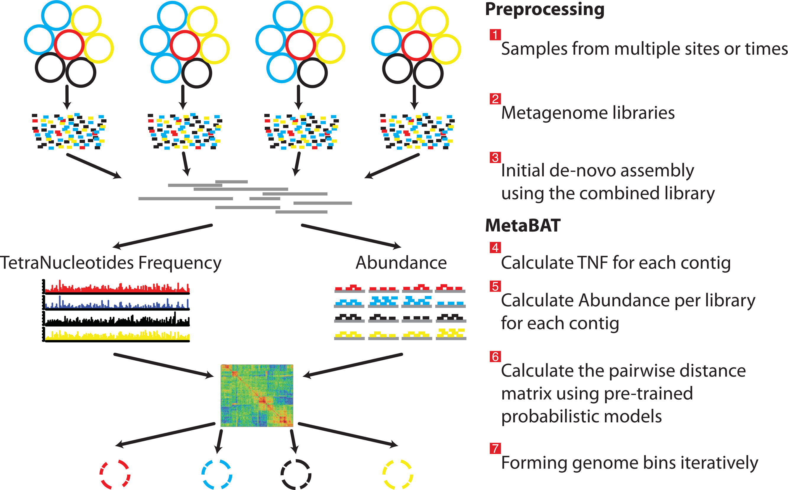
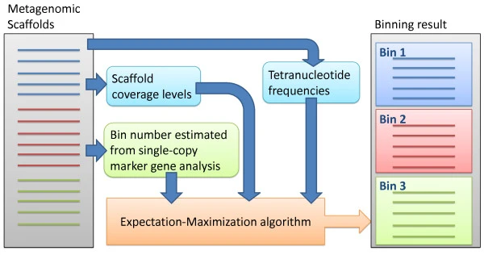
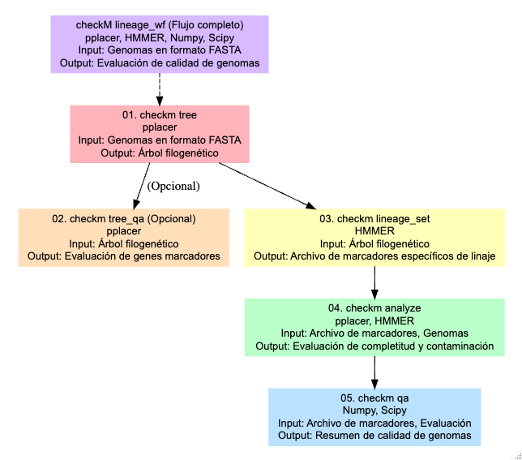
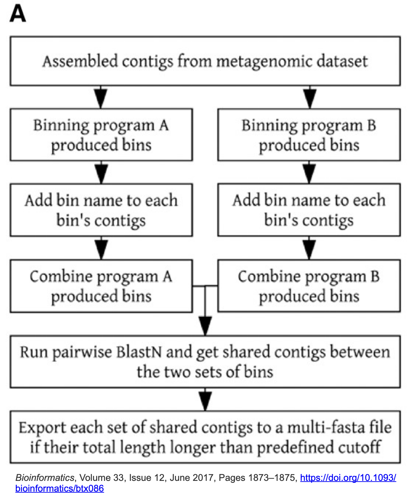
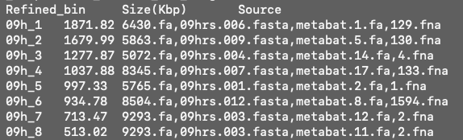
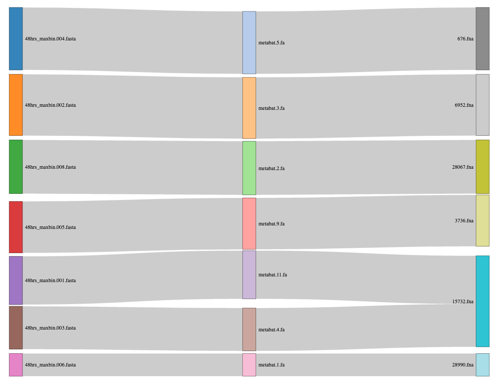
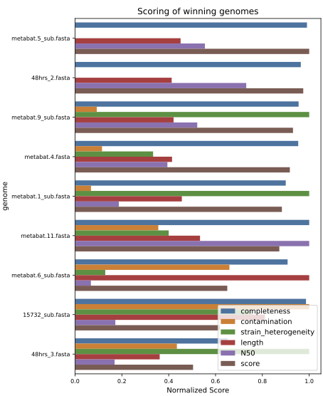

## Un recordatorio

La metagenómica hace referencia al estudio de todo el ADN de los organismos que se encuentran en un ambiente. La secuenciación de este material genético produce lecturas que pueden ensamblarse para conocer la diversidad microbiana y sus funciones.

Típicamente los metagenomas pueden estudiarse mediante dos aproximaciones:

<FONT COLOR="black">

1.  La clasificación taxonómica de contigs o lecturas y la inferencia metabólica de los contigs.
2.  **La reconstrucción de genomas a partir de metagenomas ([MAGs](https://merenlab.org/momics/)), clasificación taxonómica y la inferencia metabólica de los MAGs.**

</FONT>

En este taller nos enfocaremos en la segunda aproximación. Los **MAGs** se reconstruyen a partir de un ensamble metagenómico, los contigs de dicho ensamble se agrupan mediante la información de **cobertura y frecuencia de tetranucleótidos**. Esta agrupación puede generar errores, por lo que es indispensable evaluar la **calidad de los MAGs mediante la completitud y redundancia de genes de copia única** ([MerenLab y col.](https://anvio.org/vocabulary/))

Para obtener MAGs podemos seguir el siguiente flujo de análisis:

{fig-align="center"}

::: callout-caution
## Exploren

Antes de comenzar, reúnete con tu equipo y juntos

-   Revisen nuevamente el contenido de los directorios `Ensambles` y `Profundidad`

-   ¿Cuentan con la información necesaria para realizar el *binning*?

Tiempo: 5 min
:::

------------------------------------------------------------------------

------------------------------------------------------------------------

## 01. Binning

Ahora si, vamos a agrupar los contigs en *bins* ...

### 01.1 Metabat2

[Metabat2](https://bitbucket.org/berkeleylab/metabat/src/master/) es una herramienta que agrupa los contigs tomando la cobertura de cada contig y calcula su composición nucleotídica.

{fig-align="center" width="473"}

Ejecutemos Metabat2, pero antes vamos a crear el directorio de resultados:

``` bash
mkdir -p results/06.metabat/09hrs
```

Y ahora vamos a correrlo

``` bash
metabat2 -i results/03.ensambles/09h/v2_megahit.fasta \
 -a results/05.profundidad/09hrs/09hrs_depth.txt \
 -o results/06.metabat/09hrs/metabat -m 1500 -t 6 --seed 123
```

::: callout-important
## OJO

Estamos utilizando la opción `-m 1500` para efectos del curso y el tipo de datos que tenemos, sin embargo, esta opción podría estar demasiado laxa, hay estudios que han demostrado que el uso de contigs de longitud menor a 2000 pb puede producir malas agrupaciones de genomas (MAGs) .
:::

------------------------------------------------------------------------

:::: {.callout-caution collapse="true" title="Responde:"}
¿Cuántos bins se formaron?

::: {.callout-tip collapse="true" title="Ayuda"}
1.  `ls`
2.  `less`
:::
::::

------------------------------------------------------------------------

------------------------------------------------------------------------

### 01.2 MaxBin2

[MaxBin2](https://sourceforge.net/projects/maxbin/files/) agrupa los contigs de acuerdo a la información de cobertura, composición nucleotídica, contenido de GC y genes **marcadores de copia única**.

Vamos a ejecutarlo, activemos el [ambiente conda](#0) donde se encuentra maxbin.

::: callout-note
## Activar ambiente para MaxBin2

``` bash
conda activate maxbin2
```
:::

[{width="471"}](https://doi.org/10.1186/2049-2618-2-26)

Ahora si, vamos a ejecutarlo, pero primero creamos el lugar donde se alojaran los resultados

``` bash
mkdir -p results/07.maxbin/09hrs
```

``` bash
run_MaxBin.pl -thread 4 -min_contig_length 1500 \
 -contig results/03.ensambles/09h/v2_megahit.fasta \
 -abund results/05.profundidad/09hrs/09hrs_depth.txt \
 -out results/07.maxbin/09hrs/09hrs
```

:::: {.callout-caution title="Explora"}
## Responde

1\. ¿Cuántos bins se formaron?

2\. ¿Qué porcentaje de completitud tienen??

::: {.callout-tip collapse="true" title="Tip"}
1.  `ls + wc -l`
2.  `less`
3.  `cat archivo | column -t`
:::
::::

::: callout-caution
## Desactiva el ambiente

``` bash
conda deactivate
```
:::

### 01.3 Vamb

[VAMB](https://vamb.readthedocs.io/en/latest/) (**Variational Autoencoder for Metagenomic Binning**) agrupa contigs principalmente según sus **patrones de composición de secuencia (k-mers; por ejemplo, tetranucleótidos cuando k=4)** y su **abundancia relativa entre muestras**. Utiliza un autoencoder variacional (**red neuronal que aprende a representar datos complejos en un espacio de menor dimensión**) para reducir estas características a un espacio latente donde los contigs con perfiles similares quedan próximos; posteriormente, un algoritmo de clustering agrupa esos contigs para generar los MAGs.

::: callout-caution
## Activa el ambiente vamb

``` bash
conda activate vamb
```
:::

A vamb le gusta crear un directorio parental, pero no le gusta crear los directorios superiores, así que debemos crear el directorio que lo contendrá :/

``` bash
mkdir -p results/08.vamb
```

Corramos vamb:

``` bash
vamb bin default --fasta results/03.ensambles/09h/v2_megahit.fasta \
 --bamfiles results/05.profundidad/09hrs/09hrs.sorted.bam \
 --outdir results/08.vamb/09hrsls \
 -p 6 -m 1500 --seed 123 --minfasta 200000
```

::: callout-caution
## Responde

Si quisieras recuperar los genomas de virus ¿Qué cambiarías?
:::

::: callout-caution
## No olvides desactivar el ambiente

``` bash
conda deactivate
```
:::

### 01.4 COMEBin

[**COMEBin**](https://github.com/ziyewang/COMEBin) **(Contrastive learning-based Metagenomic Binning)** agrupa contigs utilizando principalmente sus **patrones de composición de secuencia** y **abundancia/distribución entre muestras**. Emplea **aprendizaje contrastivo** (método que aprende a acercar representaciones de datos similares y a separar las diferentes) para generar un espacio latente donde contigs pertenecientes al mismo genoma tienden a agruparse; posteriormente, realiza clustering sobre estas representaciones para generar los bins.

Este programa es muy demandante computancionalmente y por ende toma mucho más tiempo de ejecución, para esta muestra tardó 4:30 horas. Así que sólo te pondremos el ejemplo de como se ejecutó para que lo implementes en tus proyectos, pero no lo vamos a ejecutar durante el taller.

:::::: {.callout-note collapse="true"}
## COMEBin

::: callout-caution
## Activa el ambiente para COMEBin

``` bash
conda activate comebin_env
```
:::

A COMEBin también le gusta crear un directorio parental, pero no le gusta crear los directorios superiores, así que debemos crear el directorio que contendrá los resultados.

``` bash
mkdir -p results/09.comebin
```

Corremos COMEBin:

``` bash
run_comebin.sh -a results/03.ensambles/09h/v2_megahit.fasta \
 -o results/09.comebin/09hrs \
 -p results/05.profundidad/09hrs/ -t 6
```

:::: callout-important
## Nota importante

Para efectos del curso, estamos corriendo comebin en su forma más simple, sin embargo en la ayuda podemos ver algunos argumentos que controlan **cómo aprende la representación de los contigs durante el aprendizaje contrastivo**. Lo importante es distinguir entre los parámetros que afectan el modelo y los que afectan principalmente el costo computacional.

::: {.callout-tip collapse="true"}
## Argumentos

`-n INT` → **number of views**. Número de *views* (representaciones distintas de los mismos contigs) utilizadas en el aprendizaje contrastivo. Por defecto `6`. COMEBin genera múltiples vistas para que el modelo aprenda características robustas y no dependa de una única representación. **Más views → entrenamiento potencialmente más robusto, pero mayor costo computacional.**

`-l FLOAT` → **temperature** de la función de pérdida contrastiva. Controla qué tan estrictamente el modelo diferencia entre representaciones similares y diferentes. El valor por defecto es `0.07` para ensamblajes con N50 \> 10,000 y `0.15` para N50 menores. **Temperaturas más bajas hacen que la comparación contrastiva sea más "estricta" o concentrada.**

`-e INT` → **embedding size for COMEBin network**. Número de dimensiones del **espacio latente** generado por la red que aprende a partir de las características de los contigs. Por defecto `2048`. Un embedding más grande permite representar patrones más complejos, pero aumenta memoria y costo computacional.

`-c INT` → **embedding size for coverage network**. Dimensionalidad de la representación latente asociada con la **cobertura/abundancia de los contigs**. Por defecto `2048`. Es decir, COMEBin mantiene una representación de la información de cobertura que posteriormente contribuye a distinguir contigs.
:::
::::
::::::

::: callout-caution
## Explora

¿Cuántos bins hay en el directorio de resultados de COMEBin?

results/09.comebin/09hrs/comebin_res/cluster_res/unitem_profile/binning_methods/weight_seed_kmeans_k_14_result.tsv/checkm_bac/genome_quality.tsv
:::

## 02. Refinamiento

Ya corrimos cuatro programas de *binning*, pero, recordemos que los agrupamientos pueden tener errores:

{fig-align="center" width="260"}

Para disminuir la contaminación e incrementar la completitud hay algunos programas que pueden ayudarnos. Entre ellos están Binning_refiner y DASTool.

### CheckM

Antes de proceder al refinamiento es necesario tener claro cómo se evalúa la completitud y contaminación de los *bins.* Para esta evaluación se usa [CheckM](https://github.com/Ecogenomics/CheckM/wiki/Workflows#lineage-specific-workflow) que se ha convertido en una herramienta estándar para la evaluación de la [calidad de genomas](https://genome.cshlp.org/content/25/7/1043/T3.expansion.html) y MAGs, y es usada por la mayoría de programas de refinamiento.

Para hacer esta evaluación, CheckM utiliza una serie de herramientas: `tree` organiza los genomas en un árbol de referencia. `tree_qa` evalúa la cantidad de genes marcadores filogenéticos y su ubicación en el árbol. El comando `lineage_set` crea un archivo de marcadores específicos de linaje, que se usa en el comando `analyze` para evaluar la integridad y contaminación de los genomas. Finalmente, el comando `qa` genera tablas que resumen la calidad de los genomas.

{fig-align="center" width="444"}

En este taller no vamos a correr CheckM para los resultados de cada *binneador* porque uno de los programas de refinamiento que usaremos ya lo corren de forma interna, sin embargo, es útil correrlo y recomendamos hacerlo en la vida real para tener una idea clara sobre la calidad de los bins que vamos obteniendo.

Vamos a correrlo sólo como ejemplo para los resultados de Vamb para que podamos conocerlo.

Activamos el ambiente:

``` bash
conda activate checkm2
```

Vamos a crear el directorio de resultados

``` bash
mkdir -p results/08.vamb/09hrs/checkm2
```

Y ahora si lo ejecutamos

``` bash
checkm2 predict --threads 6 -x fna --input results/08.vamb/09hrs/bins/ --output-directory results/08.vamb/09hrs/checkm2/
```

::: callout-caution
## Explora

Vamos a explorar los resultados de checkm2

``` bash
less -S results/08.vamb/09hrs/checkm2/quality_report.tsv
```

Adicionalmente veamos uno de los resultados que genera comebin para comparar:

``` bash
less results/09.comebin/09hrs/comebin_res/cluster_res/unitem_profile/binning_methods/weight_seed_kmeans_k_14_result.tsv/checkm_bac/genome_quality.tsv
```
:::

Y ahora si, a refinar los *bins* ... 🥳

### Binning_refiner

[Binning_refiner](https://doi.org/10.1093/bioinformatics/btx086) se enfoca en refinar y fusionar los bins para mejorar la integridad y reducir la contaminación. Identifica *bins* que pueden representar el mismo genoma y los fusiona. Después elimina posibles contaminaciones, durante el proceso, Binning_refiner evalúa la calidad de los bins.

[{fig-align="center" width="444"}](https://doi.org/10.1093/bioinformatics/btx086)

<https://doi.org/10.1093/bioinformatics/btx086>

Necesitamos crear el directorio de resultados para binning_refiner y un directorio con los bins generados por cada programa

``` bash
mkdir -p results/10.binning_refiner/09hrsbins/{metabat,maxbin,vamb}
```

Crea ligas simbólicas de los *bins* generados por cada herramienta en el directorio que corresponde.

::: callout-tip
## Prepara los datos

Crea ligas simbólicas de los *bins* generados por cada herramienta en el directorio que corresponde de acuerdo a los directorios que acabamos de crear.

``` bash
# metabat

cd results/10.binning_refiner/09hrsbins/metabat/

ln -s ../../../06.metabat/09hrs/metabat.*.fa

# maxbin

cd ../maxbin/
ln -s ../../../07.maxbin/09hrs/*.fasta .

# vamb

cd ../vamb
ln -s ../../../08.vamb/09hrs/bins/*.fna .

# comebin

 cd ../comebin
 ln -s ../../../09.comebin/09hrs/comebin_res/comebin_res_bins/*.fa .
```
:::

Regresa al directorio de resultados de Binning_refiner para ejecutar el programa dentro de ese directorio.

``` bash
cd ../../
```

Activa el ambiente

``` bash
conda activate binning_refiner
```

Ahora si, corramos Binning_refiner

``` bash
Binning_refiner -i 09hrsbins/ -m 200 -p 09h -plot
```

Y regresemos a nuestro directorio principal

``` bash
cd && cd reads2mags_pozol/
```

Exploremos los resultados!

``` bash
cat results/10.binning_refiner/09h_Binning_refiner_outputs/09h_sources_and_length.txt 
```



{fig-align="center"}

------------------------------------------------------------------------

### DASTool

[DASTool](https://github.com/cmks/DAS_Tool) es una herramienta utilizada para mejorar la calidad de los *bins*. Evalúa la integridad, combina los resultados de diferentes *bineadores* y por consenso selecciona los mejores *bins* de cada herramienta. Una vez que DASTool ha seleccionado los mejores bins, realiza un proceso de refinamiento para optimizar los resultados.

{fig-alt="Sieber et al. 2018. Recovery of genomes from metagenomes via a dereplication, aggregation and scoring strategy. Nat. Micro." fig-align="center" width="935"}

Vamos a correr DASTool ... 🥳

``` bash
conda activate dastool
```

``` bash
nano scripts/11.dastool_09h.sh
```

``` bash
# 01. Crear el directorio para los resultados
mkdir -p results/11.dastool/09hrs

# 02. DASTool necesita como entrada un archivo tabular con información de los resultados de cada programa de binning.
Fasta_to_Contig2Bin.sh -i results/06.metabat/09hrs/ -e fa > results/11.dastool/09hrs/09hrs_metabat.dastool.tsv

Fasta_to_Contig2Bin.sh -i results/07.maxbin/09hrs/ -e fasta > results/11.dastool/09hrs/09hrs_maxbin.dastool.tsv

Fasta_to_Contig2Bin.sh -i results/08.vamb/09hrs/bins/ -e fna > results/11.dastool/09hrs/09hrs_vamb.dastool.tsv

Fasta_to_Contig2Bin.sh -i results/09.comebin/09hrs/comebin_res/comebin_res_bins/ -e fa > results/11.dastool/09hrs/09hrs_comebin.dastool.tsv

# 03. arreglar formatos de vamb y metabat
sed -i 's/ .*\t/\t/g' results/11.dastool/09hrs/09hrs_vamb.dastool.tsv

cut -f1,4 results/11.dastool/09hrs/09hrs_metabat.dastool.tsv > results/11.dastool/09hrs/09hrs_metabat.dastool.tmp.tsv && mv results/11.dastool/09hrs/09hrs_metabat.dastool.tmp.tsv results/11.dastool/09hrs/09hrs_metabat.dastool.tsv


# 04. Ya que tenemos los archivos tsv podemos empezar con el refinamiento!!
DAS_Tool -i results/11.dastool/09hrs/09hrs_metabat.dastool.tsv,results/11.dastool/09hrs/09hrs_maxbin.dastool.tsv,results/11.dastool/09hrs/09hrs_vamb.dastool.tsv,results/11.dastool/09hrs/09hrs_comebin.dastool.tsv -l metabat,maxbin,vamb,comebin -c results/03.ensambles/09h/v2_megahit.fasta -o results/11.dastool/09hrs/09hrs -t 6 --write_bins
```

Y lo corremos

``` bash
nohup bash scripts/11.dastool_09h.sh > outs/11.dastool.out &
```

------------------------------------------------------------------------

## Desreplicación

### dRep

La desreplicación es el proceso de identificar conjuntos de genomas que son "iguales" en una lista de genomas y eliminar todos los genomas excepto el "mejor" de cada conjunto redundante. [dRep](https://drep.readthedocs.io/en/latest/overview.html) es una herramienta útil para esto.

[{fig-align="center" width="423"}](https://drep.readthedocs.io/en/latest/overview.html)

Ya que tenemos los resultados de los dos refinadores ejecutaremos dRep para desreplicar y seleccionar el mejor representante de cada *bin*.

Primero vamos a crear el directorio de resultados para dRep.

``` bash
mkdir -p results/09.drep/48h/bins
```

Copia los bins que queremos comparar dentro del directorio que acabamos de crear. En este caso los generados por ambos refinadores.

Con las siguientes lineas podemos copiar los bins:

``` bash
DASTOOL="results/08.dastool/48h/48h_DASTool_bins"
BR_BINS="results/07.binning_refiner/48h_Binning_refiner_outputs/48h_refined_bins"
DREP_BINS="results/09.drep/48h/bins"

for i in $(ls $DASTOOL/*.fa); do
    name=$(basename $i .fa)
    cp $i $DREP_BINS/$name".fasta"
done

cp $BR_BINS/*.fasta $DREP_BINS
```

Y ahora si, vamos a correr dRep ...

``` bash
nano src/09.drep_48h.slurm
```

``` bash
#!/bin/bash
#SBATHC -J drep
#SBATCH -t 0
#SBATCH -e outs/09.drep48h.err
#SBATCH -o outs/09.drep48h.out
#SBATCH --export=ALL
#SBATCH -n 10
#SBATCH -N 1
#SBATCH -p q2
#SBATCH --mem 160G

export LC_ALL=en_US.UTF-8
export CHECKM_DATA_PATH=/lustre/apps/spack/opt/spack/linux-centos8-ivybridge/gcc-8.3.1/miniconda3-4.7.12.1-ubp7tlghaseisza4pqufq6sbehwa4pog/envs/mt-das-tool/db


dRep dereplicate results/09.drep/48h/ --debug -p 10 -comp 50 -con 10 -g results/09.drep/48h/bins/*.fasta
```

Este es uno de los plots generados por dRep, que representa los mejores bins desreplicados.

{fig-align="center"}

Vamos a desactivar el ambiente de dRep

``` bash
conda deactivate
```

------------------------------------------------------------------------

::: callout-important
## Para tomar en cuenta

-   En la vida real, si el proyecto de metagenómica que estás desarrollando tiene librerías de diferentes muestras usarías dRep entre todos los conjuntos de *bins* ya refinados para no tener redundancia de genomas.

-   Qué harías si antes de desreplicar tienes un bin que tiene 98 % de completitud y 11 % de contaminación?. dRep en automático lo descartaría.

Propondrías alguna manera para quedarte con este bin y curarlo para reducir su contaminación?

Por suerte hay más programas que pueden ayudarnos a curar nuestros bins manualmente, una herramienta útil para esto es [**mmgenome2**](https://kasperskytte.github.io/mmgenome2/articles/mmgenome2.html)
:::

::: callout-tip
## Tip

Ya que tenemos los *bins* refinados y desreplicados opcionalmente podrías reensamblarlos. La manera sería mapear las lecturas de toda la muestra a los *bins* finales y con las lecturas mapeadas y el *bin,* generar un ensamble genómico para cada uno. Con esta aproximación se genera un MAG más pulido y la contaminación se reduce.

Aunque en muchos reportes verás que los autores reensamblan sus MAGs, en otros no lo hacen y no hacerlo no está mal, pero hacerlo mejora la calidad.
:::

------------------------------------------------------------------------

Ahora te toca a tí

::: callout-warning
## Ejercicio 2

Ahora te toca a tí.

-   Reúnanse en equipos y repliquen todo el flujo hasta este punto con la muestra que les toca.

-   Discutan cada resultado obtenido.

-   En la [carpeta compartida de Drive](https://docs.google.com/presentation/d/1f4vaJ_fV_8-i-dja2wtFx55vRkgeAB5Y4s-opCvFI1k/edit?usp=sharing) busquen la presentación para el Ejercicio 2, en la diapositiva correspondiente resuman sus resultados obtenidos para que los presenten.

Tiempo de actividad (1.5 hr)

Tiempo de presentación de resultados (5 min por equipo)
:::
