## Un recordatorio

La metagenómica hace referencia al estudio de todo el ADN de los organismos que se encuentran en un ambiente. La secuenciación de este material genético produce lecturas que pueden ensamblarse para conocer la diversidad microbiana y sus funciones.

Típicamente los metagenomas pueden estudiarse mediante dos aproximaciones:

<FONT COLOR="black">

1.  La clasificación taxonómica de contigs o lecturas y la inferencia metabólica de los contigs.
2.  **La reconstrucción de genomas a partir de metagenomas ([MAGs](https://merenlab.org/momics/)), clasificación taxonómica y la inferencia metabólica de los MAGs.**

</FONT>

En este taller nos enfocaremos en la segunda aproximación. Los **MAGs** se reconstruyen a partir de un ensamble metagenómico, los contigs de dicho ensamble se agrupan mediante la información de **cobertura y frecuencia de tetranucleótidos**. Esta agrupación puede generar errores, por lo que es indispensable evaluar la **calidad de los MAGs mediante la completitud y redundancia de genes de copia única** ([MerenLab y col.](https://anvio.org/vocabulary/))

Para obtener MAGs podemos seguir el siguiente flujo de análisis:

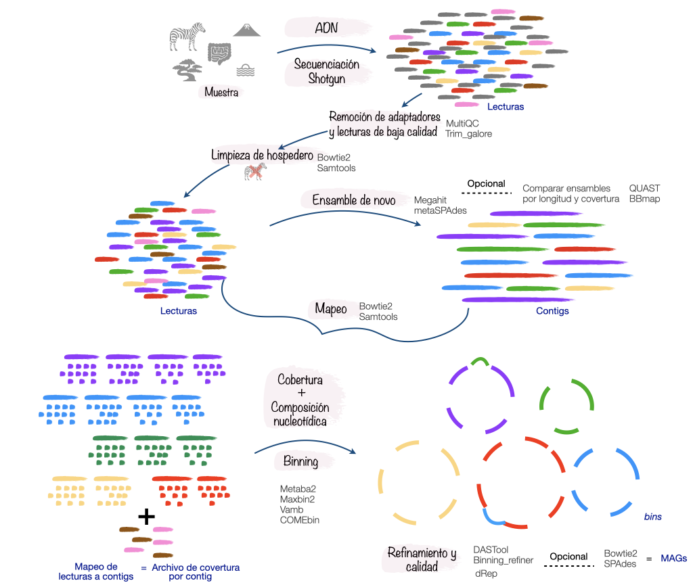{fig-align="center"}

Antes de correr las herramientas, vale la pena entender **por qué** es posible agrupar contigs en genomas. La idea común a todos los binneadores, es que los contigs que provienen de un **mismo genoma** comparten dos propiedades:

-   **Cobertura parecida.** Cada organismo está presente en cierta abundancia dentro de la muestra, así que las lecturas se mapean a *todos* sus contigs a una profundidad similar. La cobertura funciona como una huella de "cuánto hay" de ese organismo.
-   **Composición parecida.** Cada genoma tiene una firma característica en su **frecuencia de tetranucleótidos** (el patrón de k-mers, ligado a su GC y a sesgos propios), y esa firma se conserva a lo largo de todos sus contigs, sin importar qué genes lleven.

Ninguna señal basta por sí sola, dos genomas distintos pueden coincidir en abundancia, o en composición, pero combinando ambas los genomas se separan bastante bien. Por eso el archivo de profundidad que generamos antes es clave: aporta justo la señal de cobertura que el ensamble por sí solo no tiene.

A partir de aquí, **todos los binneadores usan estas mismas dos señales; lo que cambia es *cómo* las explotan** para formar los grupos. Vamos a correr cuatro, MetaBAT2, MaxBin2, VAMB y COMEBin, y a comparar sus resultados.

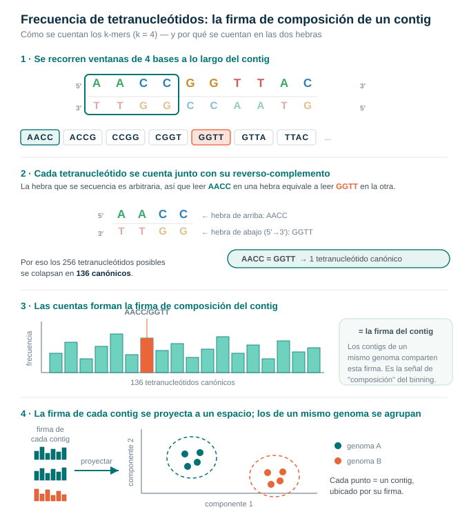{fig-align="center" width="637"}

::: callout-caution
## Exploren

Antes de comenzar, reúnete con tu equipo y juntos

-   Revisen nuevamente el contenido de los directorios `Ensambles` y `Profundidad`

-   ¿Cuentan con la información necesaria para realizar el *binning*?

Tiempo: 5 min
:::

------------------------------------------------------------------------

------------------------------------------------------------------------

## 01. Binning

Ahora si, vamos a agrupar los contigs en *bins* ...

### 01.1 Metabat2

[MetaBAT2](https://bitbucket.org/berkeleylab/metabat/src/master/) agrupa los contigs usando dos señales: su **cobertura** (la profundidad a la que se secuenció cada contig) y su **composición nucleotídica** (la frecuencia de tetranucleótidos). Lo que lo distingue es *cómo* los agrupa: combina esas dos señales en una sola **distancia** entre cada par de contigs y, sobre ese grafo de distancias, aplica un **agrupamiento** que reúne en un mismo bin a los contigs cercanos. Es el enfoque clásico basado en distancias, rápido y muy usado, y por eso suele tomarse como punto de comparación.

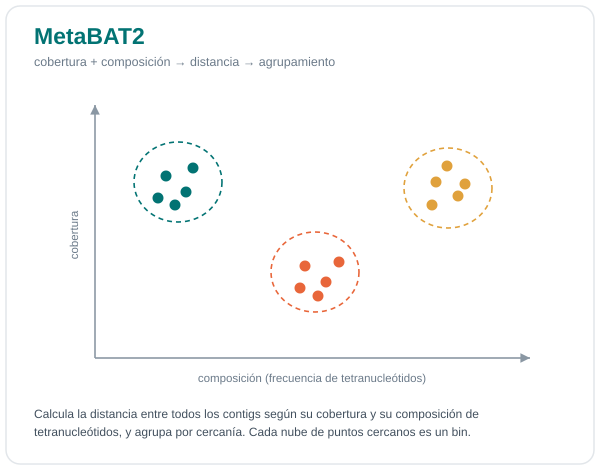{fig-align="center" width="438"}

Ejecutemos Metabat2, pero antes vamos a crear el directorio de resultados:

``` bash
mkdir -p results/06.metabat/0h
```

Y ahora vamos a correrlo

``` bash
metabat2 -i results/03.ensambles/0h/v3.spades.fasta \
 -a results/05.profundidad/0h/0h_depth.txt \
 -o results/06.metabat/0h/metabat -m 1500 -t 6 --seed 123
```

::: callout-important
## OJO

Estamos utilizando la opción `-m 1500` para efectos del curso y el tipo de datos que tenemos, sin embargo, esta opción podría estar demasiado laxa, hay estudios que han demostrado que el uso de contigs de longitud menor a 2000 pb puede producir malas agrupaciones de genomas (MAGs) .
:::

------------------------------------------------------------------------

:::: {.callout-caution title="Responde:"}
¿Cuántos bins se formaron?

::: {.callout-tip collapse="true" title="Ayuda"}
1.  `ls`
2.  `less`
:::
::::

------------------------------------------------------------------------

------------------------------------------------------------------------

### 01.2 MaxBin2

[MaxBin2](https://sourceforge.net/projects/maxbin/files/) agrupa los contigs usando su **cobertura**, su **composición nucleotídica** (frecuencia de tetranucleótidos) y su **contenido de GC**, pero lo que lo distingue es *cómo* los agrupa: con un algoritmo de Expectation–Maximization **(EM)** sembrado con **genes marcadores de copia única**.

EM resuelve el problema de no poder asignar cada contig a un bin sin saber cómo es cada bin y no poder describir cada bin sin saber qué contigs lo forman. Para romper ese círculo itera dos pasos: en el paso **E** calcula la *probabilidad* de que cada contig pertenezca a cada bin y en el paso **M** recalcula el perfil de cada bin (su cobertura y composición) ponderando cada contig por esa probabilidad. Repite E→M hasta que las asignaciones se estabilizan.

Aquí entran los **genes marcadores de copia única**: como se espera una sola copia por genoma, MaxBin los usa como semilla para estimar **cuántos genomas hay** y desde dónde arrancar la iteración; esos mismos marcadores le permiten además reportar la **completitud** de cada bin.

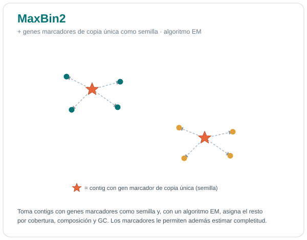{fig-align="center" width="438"}

Vamos a ejecutarlo, activemos el [ambiente conda](#0) donde se encuentra maxbin.

::: callout-note
## Activar ambiente para MaxBin2

``` bash
conda activate maxbin2
```
:::

Ahora si, vamos a ejecutarlo, pero primero creamos el lugar donde se alojaran los resultados

``` bash
mkdir -p results/07.maxbin/0h
```

Debemos formatear el archivo de abundancia para MaxBin:

``` bash
cut -f1,4 results/05.profundidad/0h/0h_depth.txt  > results/05.profundidad/0h/0h_depth_maxbin.txt
```

Y ahora si, corramos MaxBin

``` bash
run_MaxBin.pl -thread 4 -min_contig_length 1500 \
 -contig results/03.ensambles/0h/v3.spades.fasta \
 -abund results/05.profundidad/0h/0h_depth_maxbin.txt \
 -out results/07.maxbin/0h/0h
```

:::: {.callout-caution title="Explora"}
## Responde

1\. ¿Cuántos bins se formaron?

2\. ¿Qué porcentaje de completitud tienen??

::: {.callout-tip collapse="true" title="Tip"}
1.  `ls + wc -l`
2.  `less`
3.  `cat archivo | column -t`
:::
::::

::: callout-caution
## Desactiva el ambiente

``` bash
conda deactivate
```
:::

### 01.3 Vamb

[VAMB](https://vamb.readthedocs.io/en/latest/) (**Variational Autoencoder for Metagenomic Binning**) agrupa contigs principalmente según sus patrones de composición de secuencia (k-mers; por ejemplo, tetranucleótidos cuando k=4) y su abundancia relativa entre muestras. Utiliza un autoencoder variacional (**red neuronal que aprende a representar datos complejos en un espacio de menor dimensión**) para reducir estas características a un espacio latente donde los contigs con perfiles similares quedan próximos; posteriormente, un algoritmo de clustering agrupa esos contigs para generar los MAGs.

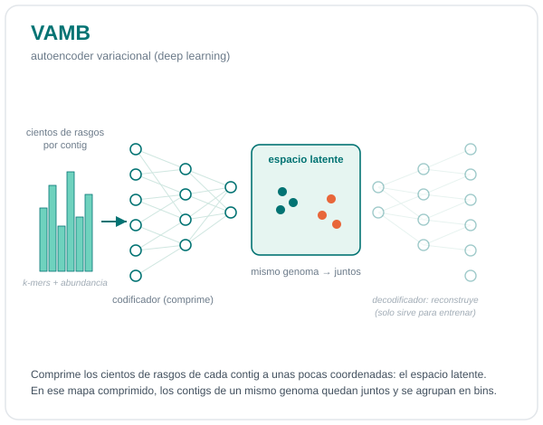{fig-align="center" width="438"}

::: callout-caution
## Activa el ambiente vamb

``` bash
conda activate vamb
```
:::

A vamb le gusta crear un directorio parental, pero no le gusta crear los directorios superiores, así que debemos crear el directorio que lo contendrá :/

``` bash
mkdir -p results/08.vamb
```

Corramos vamb:

``` bash
vamb bin default --fasta results/03.ensambles/0h/v3.spades.fasta  --bamfiles results/05.profundidad/0h/0h.sorted.bam  --outdir results/08.vamb/0h  -p 6 -m 1000 --seed 123 --minfasta 50000
```

::: callout-warning
## ¿Por qué bajamos los umbrales aquí? (y por qué tú no deberías)

La muestra de 0 h es de **baja biomasa**: la fermentación apenas comienza, hay poco ADN microbiano y el ensamble produce pocos contigs y cortos. VAMB entrena una red neuronal y, con tan pocos datos, con los umbrales normales no logra escribir ni un bin. **Solo para que el taller corra rápido y puedan ver el flujo completo de refinamiento**, relajamos dos parámetros de VAMB en esta muestra: `-m 1000` (longitud mínima de contig) y `--minfasta 50000` (tamaño mínimo de bin a escribir).

**Esto no debe hacerse en un análisis real.** Usar contigs de \~1000 pb degrada el binning: incluir contigs menores a \~2500 pb produce agrupaciones de peor calidad y menor precisión ([Alneberg et al., 2014](https://doi.org/10.1038/nmeth.3103)). La razón ya la vimos en la figura de tetranucleótidos: un contig corto reparte sus \~1000 ventanas entre cientos de tetranucleótidos posibles, así que hay muy pocas cuentas de cada uno y su **firma de composición es ruidosa**, el binneador lo ubica mal en el espacio y contamina los grupos. En tus proyectos, mantén el mínimo en **1500–2500 pb o más**, y reserva los umbrales bajos para casos como este: una demostración con datos pequeños.
:::

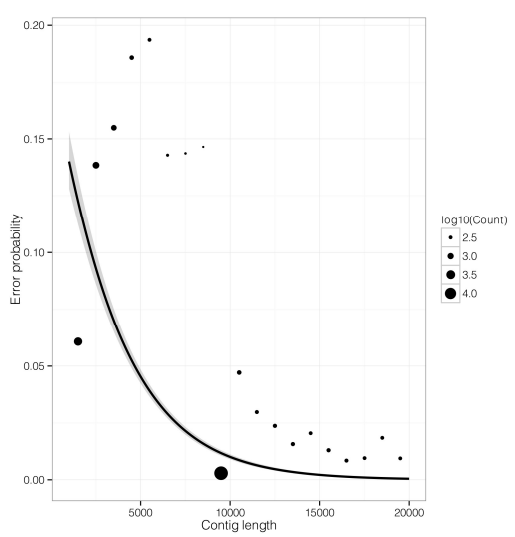{fig-align="center" width="368"}

::: callout-caution
## Responde

Si quisieras recuperar los genomas de virus ¿Qué cambiarías?
:::

::: callout-caution
## No olvides desactivar el ambiente

``` bash
conda deactivate
```
:::

### 01.4 COMEBin

[**COMEBin**](https://github.com/ziyewang/COMEBin) **(Contrastive learning-based Metagenomic Binning)** agrupa contigs utilizando principalmente sus patrones de composición de secuencia y abundancia/distribución entre muestras. Emplea **aprendizaje contrastivo** (método que aprende a acercar representaciones de datos similares y a separar las diferentes) para generar un espacio latente donde contigs pertenecientes al mismo genoma tienden a agruparse; posteriormente, realiza clustering sobre estas representaciones para generar los bins.

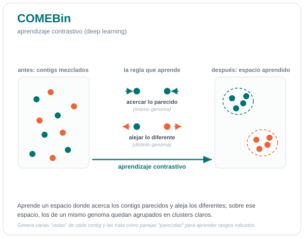{fig-align="center" width="438"}

Este programa es muy demandante computacionalmente y por ende toma mucho más tiempo de ejecución, para esta muestra tardó 4:30 horas. Así que sólo te pondremos el ejemplo de como se ejecutó para que lo implementes en tus proyectos, pero no lo vamos a ejecutar durante el taller.

:::::: {.callout-note collapse="true"}
## COMEBin

::: callout-caution
## Activa el ambiente para COMEBin

``` bash
conda activate comebin_env
```
:::

A COMEBin también le gusta crear un directorio parental, pero no le gusta crear los directorios superiores, así que debemos crear el directorio que contendrá los resultados.

``` bash
mkdir -p results/09.comebin
```

Corremos COMEBin:

``` bash
run_comebin.sh -a results/03.ensambles/0h/v3.spades.fasta \
 -o results/09.comebin/0h \
 -p results/05.profundidad/0h/ -t 6
```

:::: callout-important
## Nota importante

Para efectos del curso, estamos corriendo comebin en su forma más simple, sin embargo en la ayuda podemos ver algunos argumentos que controlan **cómo aprende la representación de los contigs durante el aprendizaje contrastivo**. Lo importante es distinguir entre los parámetros que afectan el modelo y los que afectan principalmente el costo computacional.

::: {.callout-tip collapse="true"}
## Argumentos

`-n INT` → **number of views**. Número de *views* (representaciones distintas de los mismos contigs) utilizadas en el aprendizaje contrastivo. Por defecto `6`. COMEBin genera múltiples vistas para que el modelo aprenda características robustas y no dependa de una única representación. **Más views → entrenamiento potencialmente más robusto, pero mayor costo computacional.**

`-l FLOAT` → **temperature** de la función de pérdida contrastiva. Controla qué tan estrictamente el modelo diferencia entre representaciones similares y diferentes. El valor por defecto es `0.07` para ensamblajes con N50 \> 10,000 y `0.15` para N50 menores. **Temperaturas más bajas hacen que la comparación contrastiva sea más "estricta" o concentrada.**

`-e INT` → **embedding size for COMEBin network**. Número de dimensiones del **espacio latente** generado por la red que aprende a partir de las características de los contigs. Por defecto `2048`. Un embedding más grande permite representar patrones más complejos, pero aumenta memoria y costo computacional.

`-c INT` → **embedding size for coverage network**. Dimensionalidad de la representación latente asociada con la **cobertura/abundancia de los contigs**. Por defecto `2048`. Es decir, COMEBin mantiene una representación de la información de cobertura que posteriormente contribuye a distinguir contigs.
:::
::::
::::::

::: callout-caution
## Explora

¿Cuántos bins hay en el directorio de resultados de COMEBin?
:::

::: callout-note
## Comparativa entre binneadores

Cada programa dio un número distinto de bins. ¿Por qué?

Recordemos lo que usa cada uno: cobertura + tetranucleótidos (MetaBAT), + marcadores de copia única (MaxBin), autoencoder (VAMB), aprendizaje contrastivo (COMEBin).
:::

## 02. Refinamiento

Ya corrimos cuatro programas de *binning*, pero, recordemos que los agrupamientos pueden tener errores:

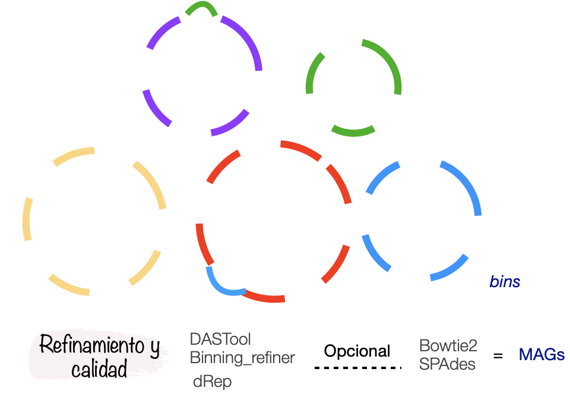{fig-align="center" width="260"}

Para disminuir la contaminación e incrementar la completitud hay algunos programas que pueden ayudarnos. Entre ellos están MAGScoT y DASTool.

### 02.1 CheckM2

Antes de refinar necesitamos una forma de medir qué tan buenos son los *bins* que vamos obteniendo. Dos números resumen su calidad: la **completitud** (qué fracción del genoma esperado está presente) y la **contaminación** o redundancia (cuánto material de *otros* genomas se coló en el mismo *bin*). Para estimar ambas usaremos [CheckM2](https://github.com/chklovski/CheckM2), que se ha vuelto el estándar para evaluar la [calidad de genomas y MAGs](https://genome.cshlp.org/content/25/7/1043/T3.expansion.html).

A diferencia de su antecesor **CheckM1** —que colocaba cada genoma en un **árbol de referencia** y contaba **genes marcadores de copia única específicos de cada linaje** (su presencia estima la completitud y su duplicación, la contaminación)— **CheckM2** estima la calidad con **modelos de aprendizaje automático** entrenados sobre miles de genomas. En lugar de depender de marcadores por linaje, predice la completitud y la contaminación a partir de las características del propio genoma. Esto lo hace:

-   **más rápido y mucho más ligero en memoria**, porque no construye árboles filogenéticos ni usa `pplacer`;
-   **más preciso en organismos poco representados** en las bases de datos o con **genomas reducidos** y biología inusual (p. ej. Patescibacteria, Nanoarchaeota), donde CheckM1 subestimaba la calidad por falta de marcadores.

Por dentro, CheckM2 predice los genes con **Prodigal**, los anota con **DIAMOND** contra una base de referencia y con esas características alimenta sus modelos: uno de **contaminación** y uno de **completitud** que elige automáticamente entre un modelo *general* (para organismos novedosos) y uno *específico* (para organismos cercanos al set de entrenamiento). Por eso, en la salida verás una columna que indica qué modelo se usó para cada MAG.

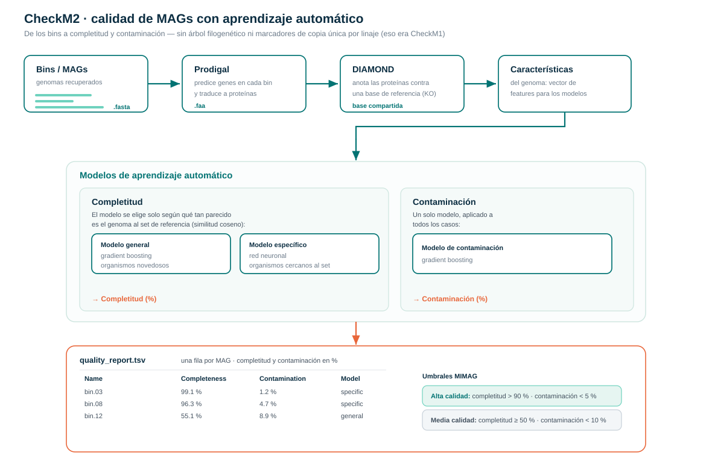{fig-align="center" width="938"}

::: callout-tip
## Sobre correr CheckM2 en cada binneador

En el taller **no** correremos CheckM2 sobre los cuatro binneadores, solo por tiempo. Lo ejecutaremos como ejemplo sobre los *bins* de **Metabat** para conocer la herramienta y su salida. Más adelante volveremos a usarlo sobre el conjunto **ya refinado**, y esa salida nos servirá además como insumo para **dRep**. En tus proyectos sí es muy recomendable evaluar la calidad de los *bins* de cada binneador para ir teniendo una idea clara conforme avanzas.
:::

Vamos a crear el directorio de resultados

``` bash
mkdir -p results/06.metabat/0h/checkm2
```

Declarar los nucleos

``` bash
export OMP_NUM_THREADS=2
export TF_NUM_INTRAOP_THREADS=2
export TF_NUM_INTEROP_THREADS=1
```

Y ahora si lo ejecutamos

``` bash
checkm2 predict --threads 2 -x fa \
 --input results/06.metabat/0h/ \
 --output-directory results/06.metabat/0h/checkm2
```

::: callout-caution
## Explora

Vamos a explorar los resultados de checkm2

``` bash
less -S results/06.metabat/0h/checkm2/quality_report.tsv
```

Es un archivo tabular con una fila por *bin*. Las columnas clave son **`Completeness`** y **`Contamination`** (en porcentaje); también trae `Completeness_Model_Used`, densidad de codificación, N50, tamaño del genoma y GC.
:::

::: callout-note
## Criterios MIMAG

Los criterios **MIMAG (Minimum Information about a Metagenome-Assembled Genome)** establecen estándares para evaluar la calidad de los MAGs, considerando principalmente la **completitud**, que representa el porcentaje estimado del genoma recuperado, y la **contaminación**, que indica la proporción de secuencias provenientes de otros genomas; además, se considera la consistencia del MAG y la presencia de genes esenciales. De manera general, los MAGs se clasifican como **alta calidad** cuando presentan ≥90% de completitud y ≤5% de contaminación, **calidad media** cuando presentan ≥50% de completitud y ≤10% de contaminación, y **baja calidad** cuando tienen \<50% de completitud. Para considerar un MAG de **alta calidad** bajo MIMAG también se requiere evidencia adicional, como la presencia de los rRNA 5S, 16S y 23S y un conjunto suficiente de tRNAs. Herramientas como **CheckM** permiten estimar principalmente la completitud y contaminación, pero la clasificación MIMAG completa requiere evaluar también estos marcadores genéticos.
:::

::: callout-caution
## Responde

1.  Clasifica los *bins* de Metabat según los estándares **MIMAG**: alta calidad (\>90 % completitud, \<5 % contaminación) y media calidad (≥50 %, \<10 %). ¿Cuántos hay de cada uno?
2.  ¿Por qué una contaminación alta es más problemática que una completitud baja para los análisis que siguen (taxonomía, metabolismo)?
:::

Y ahora si, a refinar los *bins* ... 🥳

------------------------------------------------------------------------

### 2.2 DASTool

[DAS_Tool](https://github.com/cmks/DAS_Tool) toma los bins de todos los binneadores y **puntúa cada candidato** según sus **genes de copia única**, con lo que estima su completitud y contaminación (por eso no depende de CheckM). Después selecciona un conjunto **no redundante**, quedándose con la mejor versión de cada genoma entre todas las herramientas, e incluso ajusta los bins añadiendo contigs para mejorar ese puntaje. A diferencia de Binning_refiner, que conserva la intersección, DAS_Tool **elige y optimiza** los bins de mayor puntaje.

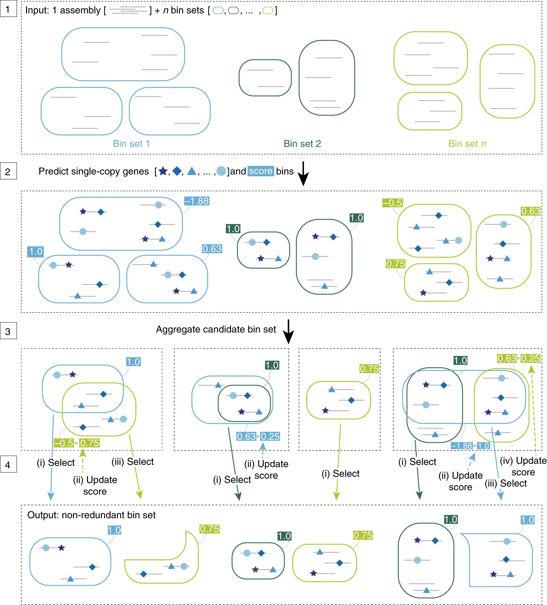{fig-alt="Sieber et al. 2018. Recovery of genomes from metagenomes via a dereplication, aggregation and scoring strategy. Nat. Micro." fig-align="center" width="535"}

Vamos a correr DASTool ... 🥳

``` bash
conda activate dastool
```

``` bash
nano scripts/10.dastool_0h.sh
```

``` bash
# 01. Crear el directorio para los resultados
mkdir -p results/10.dastool/0h

# 02. DASTool necesita como entrada un archivo tabular con información de los resultados de cada programa de binning.
Fasta_to_Contig2Bin.sh -i results/06.metabat/0h/ -e fa > results/10.dastool/0h/0h_metabat.dastool.tsv

Fasta_to_Contig2Bin.sh -i results/07.maxbin/0h/ -e fasta > results/10.dastool/0h/0h_maxbin.dastool.tsv

Fasta_to_Contig2Bin.sh -i results/08.vamb/0h/bins/ -e fna > results/10.dastool/0h/0h_vamb.dastool.tsv

Fasta_to_Contig2Bin.sh -i results/09.comebin/0h/comebin_res/comebin_res_bins/ -e fa > results/10.dastool/0h/0h_comebin.dastool.tsv

# 03. arreglar formatos de vamb y metabat
sed -i 's/ .*\t/\t/g' results/10.dastool/0h/0h_vamb.dastool.tsv

cut -f1,4 results/10.dastool/0h/0h_metabat.dastool.tsv > results/10.dastool/0h/0h_metabat.dastool.tmp.tsv && mv results/10.dastool/0h/0h_metabat.dastool.tmp.tsv results/10.dastool/0h/0h_metabat.dastool.tsv


# 04. Ya que tenemos los archivos tsv podemos empezar con el refinamiento!!
DAS_Tool -i results/10.dastool/0h/0h_metabat.dastool.tsv,results/10.dastool/0h/0h_maxbin.dastool.tsv,results/10.dastool/0h/0h_vamb.dastool.tsv,results/10.dastool/0h/0h_comebin.dastool.tsv -l metabat,maxbin,vamb,comebin -c results/03.ensambles/0h/v3.spades.fasta -o results/10.dastool/0h/0h -t 6 --write_bins
```

Y lo corremos

``` bash
nohup bash scripts/10.dastool_0h.sh > outs/10.dastool.out &
```

------------------------------------------------------------------------

### 2.2 MAGScoT

Como segundo refinador usaremos [MAGScoT](https://github.com/ikmb/MAGScoT), una herramienta más reciente y ligera. Comparte la misma filosofía que DAS_Tool, puntúa cada bin candidato usando **genes marcadores de copia única** y selecciona de forma iterativa el mejor conjunto **no redundante**, sin depender de CheckM, pero agrega un paso propio: **fusiona bins que se solapan** entre binneadores para formar *bins híbridos* y los mete también a la competencia. A veces ese híbrido resulta mejor que cualquiera de los bins originales.

::: callout-note
## ¿Por qué correr *dos* refinadores?

DAS_Tool y MAGScoT hacen algo parecido, pero no idéntico (MAGScoT además fusiona bins). Correr ambos sobre la misma muestra nos deja **compararlos** Antes usábamos Binning_refiner para esto, pero es la herramienta más antigua del grupo y cada vez se usa menos.
:::

Todo el flujo de MAGScoT está en un solo script, que hace cinco cosas: (1) predice los ORFs del ensamble con **Prodigal**, (2) los anota contra los marcadores de **GTDB r207** con **HMMER**, (3) arma la tabla contig-a-bin reutilizando las de DAS_Tool, (4) puntúa y refina con MAGScoT, y (5) extrae los MAGs a FASTA (porque MAGScoT entrega solo el mapeo, no los genomas).

Todo el flujo de MAGScoT está en un solo script, que hace cinco cosas: (1) predice los ORFs del ensamble con **Prodigal**, (2) los anota contra los marcadores de **GTDB r207** con **HMMER**, (3) arma la tabla contig-a-bin reutilizando las de DAS_Tool, (4) puntúa y refina con MAGScoT, y (5) extrae los MAGs a FASTA (porque MAGScoT entrega solo el mapeo, no los genomas).

Primero activamos el ambiente

``` bash
conda activate MAGScoT_env
```

E instalaremos una libreria dentro del ambiente

``` bash
pip install --user pandas
```

Creamos el script de ejecución

``` bash
nano scripts/11.magscot_0h.sh
```

``` bash
#!/usr/bin/bash

# Diana Oaxaca
# Refinamiento de bins con MAGScoT (predice ORFs, anota marcadores GTDB,
# puntua y selecciona MAGs, y extrae los FASTA para dRep)


#Variables
MAGSCOT=/data/env/MAGScoT_env/MAGScoT                          
asm=results/03.ensambles/0h/v3.spades.fasta     
DT=results/10.dastool/0h                         
out=results/11.magscot/0h                        
threads=6

mkdir -p $out/bins

# 1. Prediccion de ORFs con Prodigal 
prodigal -p meta -i $asm -a $out/0h.faa -d $out/0h.ffn -o /dev/null

# 2. Anotacion de marcadores de copia unica (HMMER vs GTDB r207)

hmmsearch -o $out/tigr.out --tblout $out/tigr.hit --noali --notextw --cut_nc --cpu $threads \
  $MAGSCOT/hmm/gtdbtk_rel207_tigrfam.hmm $out/0h.faa
hmmsearch -o $out/pfam.out --tblout $out/pfam.hit --noali --notextw --cut_nc --cpu $threads \
  $MAGSCOT/hmm/gtdbtk_rel207_Pfam-A.hmm $out/0h.faa

grep -v "^#" $out/tigr.hit | awk '{print $1"\t"$3"\t"$5}' >  $out/0h.hmm
grep -v "^#" $out/pfam.hit | awk '{print $1"\t"$4"\t"$5}' >> $out/0h.hmm

# 3. Tabla contig-a-bin
awk '{print $2"\t"$1"\tmetabat2"}' $DT/0h_metabat.dastool.tsv  >  $out/contigs_to_bin.tsv
awk '{print $2"\t"$1"\tmaxbin2"}'  $DT/0h_maxbin.dastool.tsv   >> $out/contigs_to_bin.tsv
awk '{print $2"\t"$1"\tvamb"}'     $DT/0h_vamb.dastool.tsv     >> $out/contigs_to_bin.tsv
awk '{print $2"\t"$1"\tcomebin"}'  $DT/0h_comebin.dastool.tsv  >> $out/contigs_to_bin.tsv

# 4. Puntaje y refinamiento con MAGScoT
python3 $MAGSCOT/MAGScoT.py -i $out/contigs_to_bin.tsv --hmm $out/0h.hmm -o $out/0h

# 5. Extraccion de los FASTA (MAGScoT solo da el mapeo)
tail -n +2 $out/0h.refined.contig_to_bin.out | \
 awk -v d="$out/bins" '{b=$1; sub(/.*\//,"",b); print $2 >> d"/"b".ctg"}'

shopt -s nullglob
for f in $out/bins/*.ctg; do
  b=$(basename $f .ctg)
  seqkit grep -f $f $asm > $out/bins/$b.fasta
done
rm -f $out/bins/*.ctg
```

``` bash
nohup bash scripts/11.magscot_0h.sh > outs/11.magscot_0h.out &
```

::: callout-caution
## Explora y compara (5 min)

Ya tienes las salidas de **DAS_Tool** y **MAGScoT** sobre la misma muestra. Compáralas:

1.  ¿Cuántos MAGs recuperó cada refinador? ¿Coinciden?
2.  Revisa la columna `is_magscot` en `0h.scores.out`: ¿alguno de los MAGs finales es un **bin híbrido** (fusionado por MAGScoT), o todos venían tal cual de un binneador?
3.  Si ambos parten de los mismos bins, ¿por qué no dan exactamente el mismo resultado?
:::

## 03. Desreplicación

### dRep

La desreplicación es el proceso de identificar conjuntos de genomas que son "iguales" en una lista de genomas y eliminar todos los genomas excepto el "mejor" de cada conjunto redundante. [dRep](https://drep.readthedocs.io/en/latest/overview.html) es una herramienta útil para esto. Para decidir qué genomas son "iguales", dRep los agrupa por **ANI** (identidad promedio de nucleótidos) por encima de un umbral; y para elegir el "mejor" de cada grupo usa una **puntuación de calidad** (completitud, contaminación, N50). Por eso los argumentos `-comp`, `-con` y el umbral de ANI son los que deciden qué entra y qué gana.

[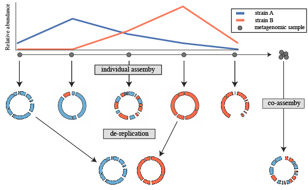{fig-align="center" width="423"}](https://drep.readthedocs.io/en/latest/overview.html)

Ya que tenemos los resultados de los dos refinadores ejecutaremos dRep para desreplicar y seleccionar el mejor representante de cada *bin*.

Primero vamos a crear el directorio de resultados para dRep.

``` bash
mkdir -p results/12.drep/0h/bins
```

Copia los bins que queremos comparar dentro del directorio que acabamos de crear. A dRep le tenemos que dar como entrada un directorio con todos los bins y la misma extensión.

Con las siguientes lineas podemos copiar los bins resultantes de cada refinamiento:

``` bash
DT="results/10.dastool/0h/0h_DASTool_bins"
MS="results/11.magscot/0h/bins"
out="results/12.drep/0h/bins"

for i in $(ls $DT/*.fa); do
    name=$(basename $i .fa)
    cp $i $out/$name".fasta"
done

cp $MS/*.fasta $out
```

Preparemos el insumo de dRep, para ello corramos checkm2

Declarar los nucleos

``` bash
export OMP_NUM_THREADS=2
export TF_NUM_INTRAOP_THREADS=2
export TF_NUM_INTEROP_THREADS=1
```

y ahora si ...

``` bash
checkm2 predict --threads 2 -x fasta --input results/12.drep/0h/bins/ --output-directory results/12.drep/0h/checkm2/
```

Y ahora toca construir el archivo de información que dRep necesita.

``` bash
cq="results/12.drep/0h/checkm2/quality_report.tsv"
echo "genome,completeness,contamination" > results/12.drep/0h/genomeInfo.csv
tail -n +2 $cq | awk -F'\t' '{print $1".fasta,"$2","$3}' \
  >> results/12.drep/0h/genomeInfo.csv
```

Y ahora si, vamos a correr dRep ...

``` bash
dRep dereplicate results/12.drep/0h/ \
  -p 6 -comp 50 -con 10 \
  --genomeInfo results/12.drep/0h/genomeInfo.csv \
  -g results/12.drep/0h/bins/*.fasta
```

::: callout-caution
## Reflexionemos

¿Qué pasaría si no cambiamos los valores de los argumentos `-comp` y `-con`?

¿Y, si aumentamos el valor de `-con`?

¿Qué pasa con el porcentaje de ANI? ¿Asumimos el valor que está por defecto?
:::

------------------------------------------------------------------------

::: callout-important
## Para tomar en cuenta

-   En la vida real, si el proyecto de metagenómica que estás desarrollando tiene **librerías de diferentes muestras** usarías dRep entre todos los conjuntos de *bins* ya refinados para **eliminar redundancia de genomas.**

-   Qué harías si antes de desreplicar tienes un bin que tiene 98 % de completitud y 11 % de contaminación?. dRep en automático lo descartaría.

Propondrías alguna manera para quedarte con este bin y curarlo para reducir su contaminación?

Por suerte hay más programas que pueden ayudarnos a curar nuestros bins manualmente, una herramienta muy útil y cada vez mas utilizada es para esto es [MAGpurify2](https://apcamargo.github.io/magpurify2/docs/) pero también está [**mmgenome2**](https://kasperskytte.github.io/mmgenome2/articles/mmgenome2.html)
:::

::: callout-tip
## Tip

Ya que tenemos los *bins* refinados y desreplicados opcionalmente podrías reensamblarlos. La manera sería mapear las lecturas de toda la muestra a los *bins* finales y con las lecturas mapeadas y el *bin,* generar un ensamble genómico para cada uno. Con esta aproximación se genera un MAG más pulido y la contaminación se reduce.

Aunque en muchos reportes verás que los autores reensamblan sus MAGs, en otros no lo hacen y no hacerlo no está mal, pero hacerlo mejora la calidad.
:::

------------------------------------------------------------------------

Ahora te toca a ti

::: callout-warning
## Ejercicio 2

Ahora te toca a ti.

-   Reúnanse en equipos y repliquen todo el flujo hasta este punto con la muestra que les toca. No ejecuten COMEBin, sólo Metabat, Maxbin y Vamb.

-   Discutan cada resultado obtenido.

-   ¿Qué refinador dió mejores resultados?

-   Clasifica tus bins según MIMAG. ¿Cuántos de cada uno?

-   En la [carpeta compartida de Drive](https://docs.google.com/presentation/d/1f4vaJ_fV_8-i-dja2wtFx55vRkgeAB5Y4s-opCvFI1k/edit?usp=sharing) busquen la presentación para el Ejercicio 2, en la diapositiva correspondiente resuman sus resultados obtenidos para que los presenten.

Tiempo de actividad (1 hr)

Tiempo de presentación de resultados (5 min por equipo)
:::
