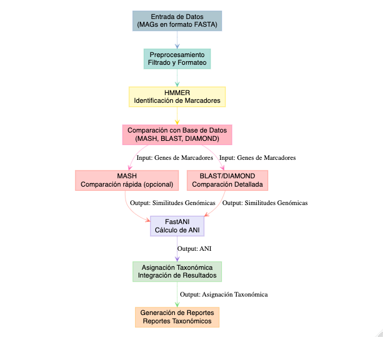
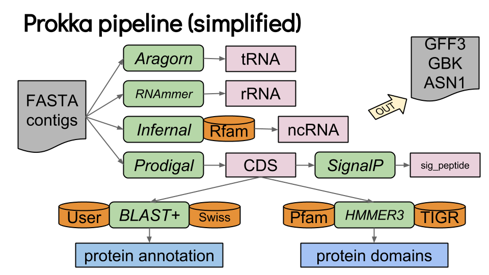

## 01. Asignación taxonómica

### GTDB-tk

GTDB-Tk es una herramienta que asigna taxonomía a genomas utilizando la base de datos [GTDB](https://gtdb.ecogenomic.org/) (Genome Taxonomy Database). Basado en árboles filogenéticos y medidas de ANI (Average Nucleotide Identity), GTDB-Tk clasifica genomas bacterianos y arqueanos, proporciona una taxonomía coherente y actualizada. Se utiliza mucho en el análisis de genomas y metagenomas.

{fig-align="center" width="944"}

Recordemos que ya tenemos un *bin* refinado y desreplicado. Ahora vamos a asignarle identidad taxonómica, para ello vamos a correr GTDB-tk

Creamos el directorio de resultados para GTDB-tk

``` bash
mkdir -p results/13.gtdbtk/0h/bins
```

Y copiamos con un nuevo nombre

``` bash
cp results/12.drep/0h/dereplicated_genomes/0h_cleanbin_000001.fasta  results/13.gtdbtk/0h/bins/0hBin01.fasta
```

::: {.callout-tip collapse="true"}
## Script para más de un MAG

Si tienes más de un MAG, que así será en las muestras de mayor tiempo de fermentación, puedes generar un ciclo for para copiar y renombrar todos.

``` bash
nano src/copiar_renombrarbins.sh
```

``` bash
#!/usr/bin/bash
destination_dir="results/13.gtdbtk/0h/bins"
count=1

for file in $(ls results/12.drep/0h/dereplicated_genomes/*.fasta); do
  new_name=$(printf "0hBin%02d.fasta" "$count")
  cp "$file" "$destination_dir/$new_name"
  count=$((count + 1))
done
```
:::

Y ahora si, ejecutamos gtdbtk

``` bash
conda activate /home/dianao/.conda/envs/gtdbtk_2.5.2
```

``` bash
export GTDBTK_DATA_PATH=/data/BD/gtdbtk/release_gtdbtk_r226_full

nohup gtdbtk classify_wf \
    --genome_dir results/13.gtdbtk/0h/bins/ \
    --out_dir results/13.gtdbtk/0h/ \
    --cpus 12 \
    -x fasta > outs/13.gtdbtk0h.out &
```

## 02. Anotación funcional

### 02.1 PROKKA

[Prokka](https://training.galaxyproject.org/training-material/topics/genome-annotation/tutorials/annotation-with-prokka/slides-plain.html) es una herramienta útil, usa diferentes programas para predecir genes, secuencias codificantes, tRNAs, rRNAs. Hace la traducción de CDS a aminoácidos y asigna funciones usando diferentes bases de datos.

{fig-align="center" width="460"}

::: callout-important
## Sólo para entender la predicción y anotación

En el taller vamos a correr prokka para entender como es el proceso de predicción genica y anotación, sin embargo cada vez se usa menos puesto que no tiene actualizaciones en su base de datos.
:::

Para correrlo vamos a activar el ambiente en el que se aloja.

::: callout-warning
## Activa el ambiente para PROKKA

``` bash
conda activate prokka
```
:::

Tenemos el ambiente activo, ahora vamos a crear un directorio de resultados para prokka.

``` bash
mkdir -p results/14.prokka/0h
```

Y ahora si le pedimos a prokka que haga a predicción y anotación del MAG que obtuvimos

``` bash
prokka --locustag 0hBin01_Scaffold \
  --prefix 0hBin01 --addgenes --addmrna \
  --cpus 6 --outdir results/14.prokka/0h/0hBin01 \
  results/13.gtdbtk/0h/bins/0hBin01.fasta
```

:::: {.callout-note collapse="true"}
## ¿Y si tuvieras más de un MAG?

Podemos hacer un ciclo que nos permita anotar todos los *bins.*

::: callout-caution
## No lo corras

Este ciclo sólo es un ejemplo de cómo correrlo para todos los bins que tengas y lo podrás usar más adelante en un ejercicio o en los bins o genomas que estés estudiando.
:::

``` bash
#!/bin/bash

# 01. Definimos variables de ubicacion de directorios de entrada y de salida
input="results/13.gtdbtk/0h/bins"
out="results/14.prokka/0h"

# 02. Ejecutamos prokka en todos los fasta
for FASTA in $(ls $input/); do
  LOCUSTAG=$(basename $FASTA .fasta)
  prokka --locustag "${LOCUSTAG}_Scaffold" \
  --prefix $LOCUSTAG --addgenes --addmrn \
  --cpus 6 --outdir "${out}/${LOCUSTAG}" \
  "${input}/${FASTA}" ;
done
```
::::

::: callout-tip
## Explora

Para tener una idea de lo que ocurre cuando ejecutas prokka, toma el ejemplo anterior y anota uno de los bins obtenidos en la muestra que le tocó a tu equipo, el que más te guste, procuren elegir bins distintos.
:::

Desactivemos el ambiente:

``` bash
conda deactivate
```

------------------------------------------------------------------------

### 02.2 Bakta

[Bakta](https://github.com/oschwengers/bakta) hace el mismo trabajo que Prokka —predice genes (CDS, tRNA, rRNA, ncRNA, CRISPR…) y les asigna función—, pero es una herramienta **actual y activamente mantenida** (Prokka lleva años prácticamente sin actualizarse), y su enfoque cambia en un punto clave. En vez de depender solo de búsquedas por homología, Bakta compara primero las proteínas contra una **base de datos versionada de secuencias proteicas únicas pre-computadas** (identificadas por su hash MD5): si una proteína ya está ahí, hereda de inmediato una anotación de alta confianza con sus referencias cruzadas (KEGG, COG, EC, GO, UniRef); las que no aparecen, pasan a una búsqueda por homología con Diamond.

Las ventajas sobre Prokka son:

-   **Menos "hypothetical protein":** al apoyarse en una base curada y grande, más genes reciben una función informativa en lugar de quedar como "proteína hipotética".

-   **Anotación más rica y trazable:** cada gen trae identificadores estables y referencias cruzadas a varias bases, así que puedes ver anotaciones de KEGG, COG o EC directo en la salida.

-   **Más tipos de elementos y salidas listas para downstream** (`.faa`, `.gff3`, `.gbff`, `.tsv`, `.json`, además de un resumen legible).

El costo es que Bakta necesita una **base de datos grande** (la completa pesa decenas de GB) y **tarda más**: en este MAG de 0 h corrió en \~15 minutos. Por eso en el taller **no lo vamos a correr en vivo**, ya dejamos sus resultados en el directorio de cada quien; de ahí tomaremos el `.faa` (las proteínas predichas) como insumo para las anotaciones que siguen, por ser la anotación más completa y actual.

::: {.callout-note collapse="true"}
## Asi se corrió (No lo ejecutes)

``` bash
conda activate bakta
```

``` bash
mkdir -p results/15.bakta/0h
```

``` bash
bakta \
    --db /data/BD/bakta_db/db \
    --locus-tag 0hBin01_Scaffold \
    --prefix 0hBin01 \
    --threads 6 \
    --output results/15.bakta/0h/0hBin01/ \
    results/13.gtdbtk/0h/bins/0hBin01.fasta
```
:::

::: callout-important
## Compara (2 min)

Ya tienes el mismo MAG anotado con Prokka (que corriste) y con Bakta (en tu directorio de resultados). En sus resúmenes, ¿cuántos genes quedaron como *hypothetical protein* en cada uno? ¿Por qué crees que difieren, y qué le cuesta a Bakta esa mejora?
:::

------------------------------------------------------------------------

------------------------------------------------------------------------

Con las proteínas predichas por Bakta ya podemos hacerles preguntas más específicas. Existen varias bases de datos especializadas, y **cada una responde algo distinto**; conviene tener claro el mapa antes de correrlas:

::: callout-note
## ¿Qué pregunta responde cada herramienta?

-   **KofamScan (KEGG):** ¿qué **rutas metabólicas** puede llevar a cabo este organismo? (asigna números KO, que se mapean a rutas)

-   **EggNOG-mapper:** ¿a qué **ortólogos / categorías COG** pertenecen sus genes? Función amplia y **comparable entre genomas**.

-   **CAZy / dbCAN:** ¿qué **enzimas activas sobre carbohidratos** tiene? Clave en un fermento de maíz, donde degradar el almidón es central.

-   **antiSMASH:** ¿tiene **clústeres de genes biosintéticos** para metabolitos secundarios (antibióticos, bacteriocinas…)?

En el taller correremos **KofamScan** en vivo; las demás las platicamos.
:::

------------------------------------------------------------------------

------------------------------------------------------------------------

### 02.3 KofamScan

[KofamScan](https://github.com/takaram/kofam_scan) es una herramienta de anotación, usa la base de datos KOfam de [KEGG](https://www.genome.jp/kegg/pathway.html) para obtener información sobre los genes que participan en diferentes rutas metabólicas.

Puedes mapear los resultados de kofam en [KEGGMapper](https://www.genome.jp/kegg/mapper/search.html)

Para correrlo necesitamos activar el ambiente donde vive kofam

``` bash
conda activate annot_fun
```

Y ahora si correrlo

``` bash
mkdir -p results/16.kofam/0h
```

``` bash
exec_annotation results/15.bakta/0h/0hBin01/0hBin01.faa -o results/16.kofam/0h/0hBin01.txt --report-unannotated --cpu 6 --tmp-dir results/16.kofam/0h/tmp -p  /data/BD/kofam/profiles/ -k  /data/BD/kofam/ko_list
```

Borramos el directorio temporal para liberar espacio

``` bash
rm -r results/16.kofam/0h/tmp
```

Y desactivamos el ambiente

``` bash
conda deactivate
```

::: callout-caution
## Veamos los resultados

Descarga el resultado de esta anotación y explorémoslos en [KEGGMapper](https://www.genome.jp/kegg/mapper/search.html)
:::

::: {.callout-note collapse="true"}
## Para correrlo con muchos genomas

Creamos el script para kofam

``` bash
# 01. Creamos el directorio para alojar los resultados
mkdir -p results/16.kofam/0h/

# 02. Lo corremos
for FAA in $(ls results/15.bakta/0h/*/*.faa); do
    name=$(basename $FAA .faa)
    exec_annotation $FAA \
        -o results/16.kofam/0h/"$name.txt" \
        --report-unannotated \
        --cpu 6 \
        --tmp-dir results/16.kofam/0h/"tmp$name" \
        -p /data/BD/kofam/profiles/ \
        -k /data/BD/kofam/ko_list
done

# 03. remover los directorios temporales
rm -r results/16.kofam/0h/tmp*
```
:::

::: callout-caution
**Ahora tú: anota todos tus MAGs con KofamScan**

Ya corriste Kofam sobre un MAG. Ahora genera los `.txt` de **todos los bins de la muestra de tu equipo** — los vas a necesitar en el análisis global. Usa el `.faa` de **Bakta** (pre-computado en tu directorio) como entrada. Apóyate en el script del callout *"Para correrlo con muchos genomas"* de arriba.

Al terminar, deberías tener un `.txt` por cada MAG en `results/16.kofam/<tu_muestra>/`. Verifica con `ls` que estén todos antes de seguir.
:::

### 02.4 EggNOG

[EggNOG-mapper](http://eggnog-mapper.embl.de/) asigna función a las proteínas a partir de **ortólogos**: genes que descienden de un ancestro común y que, por lo tanto, tienden a conservar la misma función. La herramienta compara cada proteína contra la base **eggNOG**, que agrupa genes en familias de ortólogos (**COG** y sus equivalentes) a distintos niveles taxonómicos, y le transfiere la anotación desde el ortólogo más específico que encuentra.

Genera una anotación **amplia y comparable entre genomas**: además de una descripción funcional, cada gen recibe su categoría **COG**, y referencias cruzadas a **GO, KEGG, EC, CAZy y Pfam**, entre otras. Por eso es una de las anotaciones más usadas cuando quieres comparar el repertorio funcional de varios organismos bajo un mismo marco.

::: {.callout-note collapse="true"}
## Así se corre (no lo ejecutes)

``` bash
mkdir -p results/17.eggnog/0h
nohup emapper.py --cpu 10 -m diamond --itype proteins --evalue 0.00001 \
     -i results/15.bakta/0h/0hBin01/0hBin01.faa \
     --output_dir results/17.eggnog/0h -o 0hBin01 \
     --decorate_gff yes --report_orthologs \
     --data_dir /data/BD/eggnog/emapperdb-5.0.2/ &
```
:::

### 02.5 CAZy

[Cazy](https://www.cazy.org/) es una base de datos especializada en enzimas que actúan sobre carbohidratos, esta base de datos se actualiza constantemente y es curada por una comunidad científica que busca dominios funcionales basados en evidencia experimental. Cuentan con [CAZypedia](https://www.cazypedia.org/index.php/Main_Page) para informar especificidades de cada familia cazy.

En el pozol, las CAZymes que degradan almidón del maíz son especialmente relevantes.

### 02.6 antiSMASH

Dentro de los genomas microbianos, podemos encontrar algunas regiones específicas que participan en la biosíntesis de metabolitos secundarios, estas secciones se conocen como Clústeres de Genes Biosintéticos, que son relevantes debido a las posibles aplicaciones que pueden tener, por ejemplo: actividades antimicrobianas, antitumorales, reductoras del colesterol, antivirales, etc.

[antiSMASH](https://antismash.secondarymetabolites.org/#!/start) usa modelos ocultos de Markov que permiten identificar los grupos de genes contenidos en las secuencias genómicas que codifican metabolitos secundarios de todas las clases químicas conocidas.

Si te interesa buscar BGCs en los genomas de tu interés puedes aprender siguiendo el flujo de análisis propuestos en la lección de [Minería Genómica](https://carpentries-incubator.github.io/genome-mining/) de Software Carpentry.
