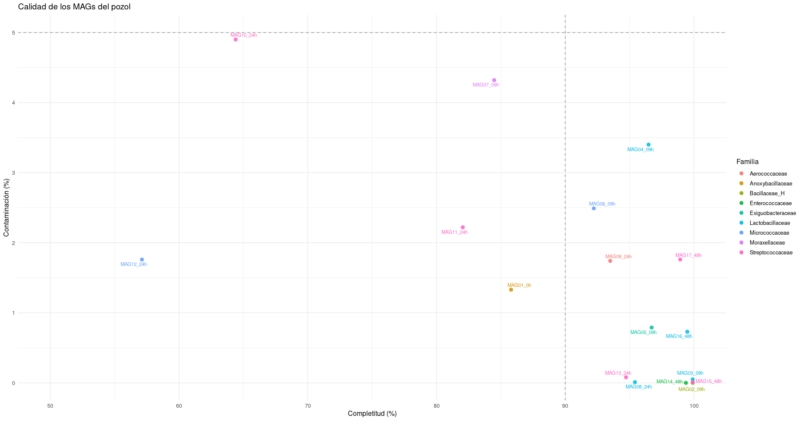
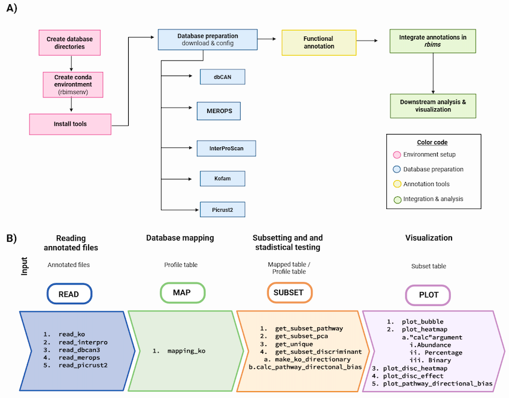
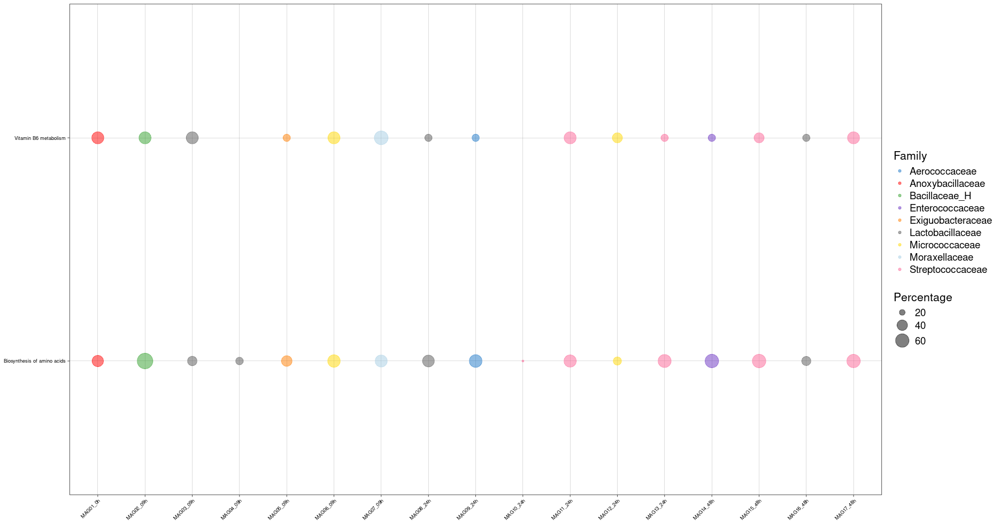
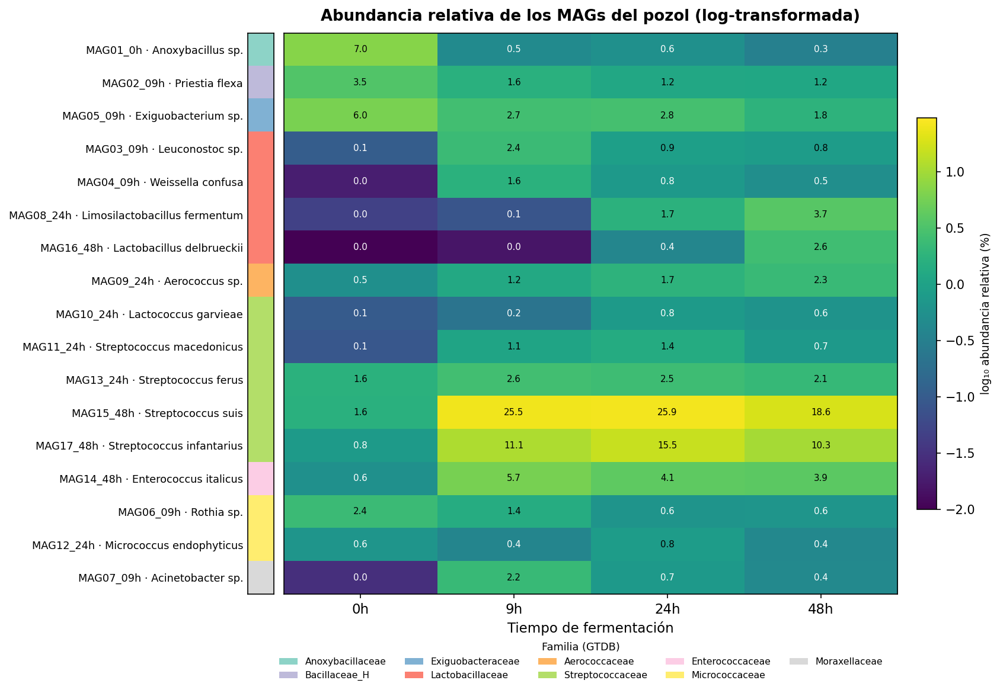

Hasta aquí, cada equipo trabajó **una** muestra: ensambló, hizo binning, refinó y anotó los MAGs de su tiempo de fermentación. En esta última parte damos el paso que convierte esos esfuerzos individuales en una sola historia: **juntamos los MAGs de todos los tiempos (0, 9, 24 y 48 h) en un catálogo común** y lo exploramos como comunidad.

-   La **desreplicación** por fin desreplica de verdad. Cuando corrimos dRep por muestra, casi no había nada que quitar. Pero entre muestras sí: es muy probable que el *mismo* organismo se haya recuperado en varios tiempos, y dRep se queda con el mejor representante de cada uno para darnos un catálogo **no redundante** del pozol.
-   La **anotación funcional** se vuelve comparativa. Un mapa de rutas de un solo MAG es una columna; el de todo el catálogo es una figura que responde ¿quién hace qué en la fermentación?.

::: callout-note
## Resultados listos

La desreplicación global y las anotaciones de todas las muestras ya están **pre-computadas** (correrlas requiere los MAGs de todos los equipos y toma tiempo). En esta sesión nos concentramos en: **construir una tabla de metadatos y explorar el catálogo con RbiMs**. En tu directorio ya tienes:

-   Los `.txt` de **KofamScan** de todos los MAGs del catálogo.
-   La tabla de **GTDB-Tk** (taxonomía) y el `quality_report` de **CheckM2** (calidad) de todo el catálogo.
:::

## 01. El catálogo de MAGs del pozol

::: {.callout-note collapse="true"}
## Así se generó el catálogo (referencia, no lo ejecutes)

``` bash
mkdir -p results/18.drep_global/bins
```

``` bash
for s in 0h 09h 24h 48h; do
  for f in results/12.drep/$s/dereplicated_genomes/*.fasta; do
    base=$(basename "$f")
    case "$base" in
      ${s}_*) new="$base" ;;
      *)      new="${s}_${base}" ;;
    esac
    cp "$f" "results/18.drep_global/bins/$new"
  done
done
```

``` bash
checkm2 predict --threads 16 -x fasta --input results/18.drep_global/bins/ --output-directory results/18.drep_global/checkm2/
```

``` bash
cq="results/18.drep_global/checkm2/quality_report.tsv"
echo "genome,completeness,contamination" > results/18.drep_global/genomeInfo.csv
tail -n +2 $cq | awk -F'\t' '{print $1".fasta,"$2","$3}' \
  >> results/18.drep_global/genomeInfo.csv
```

``` bash
dRep dereplicate results/18.drep_global \
  -p 16 -comp 50 -con 10 \
  --genomeInfo results/18.drep_global/genomeInfo.csv \
  -g results/18.drep_global/bins/*.fasta
```

``` bash
in=results/18.drep_global/dereplicated_genomes
out=results/19.gtdbtk_global/mags
mkdir -p $out

n=1
for s in 0h 09h 24h 48h; do
  for f in $(ls $in/${s}_*.fasta | sort); do
    new=$(printf "MAG%02d_%s" "$n" "$s")
    cp "$f" "$out/${new}.fasta"
    n=$((n+1))
  done
done

ls $out/*.fasta | wc -l     
```

``` bash
conda activate gtdbtk

nohup gtdbtk classify_wf \
    --genome_dir results/19.gtdbtk_global/mags/ \
    --out_dir results/19.gtdbtk_global \
    --cpus 12 \
    -x fasta > outs/19.gtdbtk-global.out &
```
:::

## 02. Construye la tabla de metadatos

Necesitamos saber, de cada MAG, **de dónde viene, qué es y qué tan bueno es**. Esa tabla que une origen + taxonomía + calidad es la **metadata**, y es la columna vertebral de cualquier figura comparativa. La vas a construir tú, porque saber armarla es una habilidad que usarás en todos tus proyectos.

::::

::: callout-note
Ingresa al directorio `results/19.gtdbtk_global`

Crea una tabla que se llame `Metadatos.tsv` **dentro del directorio de resultados de GTDB-tk** que incluya el nombre del bin y la clasificación taxonómica.

Cambia el encabezado del nombre del bin: `user_genome` por `Bin_name`

Tienes tres archivos, y cada uno aporta una pieza:

| Fuente | Aporta | Cómo llama al MAG |
|----|----|----|
| `gtdbtk.bac120.summary.tsv` | taxonomía | columna `user_genome` |
| `quality_report.tsv` (CheckM2) | completitud, contaminación | columna `Name` |
| el **nombre del MAG** | muestra de origen | p\. ej. `MAG15_48h` → `48h` |

Fíjate en el detalle: **cada tabla llama al MAG con un nombre de columna distinto** (`user_genome`, `Name`). El primer paso siempre es homogeneizar esa llave; luego, unir es fácil.
:::

Trabajaremos en R, ingresa al servidor de Rstudio `LandaLabServer` y crea un proyecto dentro del directorio `results`.

``` r
library(tidyverse)
```

### 1. Taxonomía (GTDB-Tk)

La clasificación viene como **una sola cadena** (`d__...;p__...;...`). La partimos en niveles y, de paso, sacamos la **muestra de origen** del nombre del MAG.

``` r
tax <- read_tsv(file.path("19.gtdbtk_global/gtdbtk.bac120.summary.tsv")) |>
  select(Bin_name = user_genome, classification) |>
  separate(classification,
           into = c("Domain","Phylum","Class","Order","Family","Genus","Species"),
           sep = ";", fill = "right") |>
  # quita los prefijos d__ p__ c__ ...
  mutate(across(Domain:Species, \(x) str_remove(x, "^[a-z]__"))) |>
  # el origen está en el nombre: MAG15_48h -> 48h
  mutate(Muestra_origen = str_extract(Bin_name, "\\d+h$"))
```

### 2. Calidad (CheckM2)

Solo necesitamos completitud y contaminación. Renombramos `Name` a `MAG` para que la llave coincida.

``` r
calidad <- read_tsv(file.path("19.gtdbtk_global/quality_report.tsv")) |>
  select(Bin_name = Name, Completitud = Completeness, Contaminacion = Contamination)
```

### 3. Unir todo por el nombre

``` r
metadata <- tax |>
  left_join(calidad, by = "Bin_name") |>
  arrange(Phylum, Class, Order, Family, Genus)

metadata
```

::: callout-tip
## Verifica (checkpoint)

Antes de seguir, confirma que la tabla quedó bien:

``` r
nrow(metadata)                 # ¿son tus 17 MAGs?
sum(is.na(metadata$Familia))   # ¿alguna taxonomía quedó vacía?
```

Si `nrow` no da 17, o hay `NA` inesperados, casi siempre es que un nombre de MAG no coincide entre archivos (un espacio, una extensión `.fasta` de más). Revisa con `setdiff(tax$MAG, calidad$MAG)`.
:::

Guárdala para RbiMs y para anotar cualquier figura.

``` r
write_csv(metadata, file.path("metadata_pozol.csv"))
```

::: callout-tip
## Para explorar

``` r
# Exploración de los MAGs

# 1. ¿Cuántos MAGs por familia? 
metadata |>
  count(Family, sort = TRUE)

# 2. ¿Cómo se ve la calidad por familia? 
metadata |>
  group_by(Family) |>
  summarise(
    n_MAGs        = n(),
    Compl_media   = round(mean(Completitud), 1),
    Contam_media  = round(mean(Contaminacion), 2),
    .groups = "drop"
  ) |>
  arrange(desc(n_MAGs))

# 3. Plot exploratorio: calidad de cada MAG por familia

library(ggplot2)

## barplot
ggplot(count(metadata, Family), aes(x = reorder(Family, n), y = n, fill = Family)) +
  geom_col(show.legend = FALSE) + coord_flip() +
  labs(x = NULL, y = "Nº de MAGs", title = "MAGs recuperados por familia") +
  theme_minimal(base_size = 12)

## scatterplot
ggplot(metadata, aes(x = Completitud, y = Contaminacion, color = Family)) +
  geom_hline(yintercept = 5,  linetype = "dashed", color = "grey60") +
  geom_vline(xintercept = 90, linetype = "dashed", color = "grey60") +
  geom_point(size = 2.5, alpha = 0.85) +
  scale_x_continuous(limits = c(50, 100)) +
  labs(
    title = "Calidad de los MAGs del pozol",
    x = "Completitud (%)", y = "Contaminación (%)"
  ) +
  ggrepel::geom_text_repel(aes(label = Bin_name), size = 3)+
  theme_minimal(base_size = 12)
```
:::

{fig-align="center" width="670"}

## 03. RbiMs: explora el metabolismo del catálogo

Ahora que ya tenemos los *bins* refinados, queremos saber qué capacidades metabólicas poseen. Para ello es necesario predecir sus genes y asignarles función.

[RbiMs](https://github.com/mirnavazquez/RbiMs) es un paquete de R muy útil para obtener la anotación de cada KEGG ID y generar plots de esta información. Puede trabajar con anotaciones de KOFAM, InterProScan, MEROPS, dbCAN.

{fig-align="center" width="550"}

Estos resultados ya los tienes en el directorio `results/21.kofam-global/`

Y ahora que ya tenemos los identificadores de KO para cada proteína, vamos a filtrar y graficar el metabolismo de los *bins*.

### Visualizaciones

Vamos al editor de Rstudio para correr RbiMs ✨

``` r
library(devtools)
library(rbims)

#A continuación, leemos los resultados de KEGG 
pozol_table <- read_ko(data_kofam = "21.kofam/") 

#y los mapeamos con la base de datos de KEGG:
pozol_mapp <- mapping_ko(pozol_table)

#Nos centraremos en las vías metabólicas relacionadas con la biosintesis de aminoacidos y vitaminas:

Overview <- c("Biosynthesis of amino acids", "Vitamin B6 metabolism")
Aminoacids_metabolism_pozol <- pozol_mapp %>%
  drop_na(Module_description) %>%
  get_subset_pathway(Pathway_description, Overview) 

#Visualizamos los datos con un gráfico de burbujas:

plot_bubble(tibble_ko = Aminoacids_metabolism_pozol,
            x_axis = Bin_name, 
            y_axis = Pathway_description,
            analysis = "KEGG",
            calc = "Percentage",
            range_size = c(1, 10),
            y_labs = FALSE,
            x_labs = FALSE)  

#Y generaremos un gráfico de burbujas con metadatos:

plot_bubble(tibble_ko = Aminoacids_metabolism_pozol,
            x_axis = Bin_name, 
            y_axis = Pathway_description,
            analysis = "KEGG",
            data_experiment = metadata,
            calc = "Percentage",
            color_character = Family,
            range_size = c(1, 10),
            y_labs = FALSE,
            x_labs = FALSE) 

# Exploración de una Vía Específica
# podemos explorar una sola vía, como el “Secretion system,” y crear un mapa de calor para visualizar los genes relacionados con esta vía:

Secretion_system_pozol <- pozol_mapp %>%
  drop_na(Cycle) %>%
  get_subset_pathway(Cycle, "Secretion system")

#Y, finalmente, generamos un mapa de calor:

plot_heatmap(tibble_ko = Secretion_system_pozol, 
             y_axis = Genes,
             analysis = "KEGG",
             calc = "Binary")

#También podemos agregar metadatos para obtener una visión más completa:

plot_heatmap(tibble_ko = Secretion_system_pozol, 
             y_axis = Genes,
             data_experiment = Metadatos,
             order_x = Family,
             analysis = "KEGG",
             calc = "Binary")

plot_heatmap(tibble_ko = Secretion_system_pozol, 
             y_axis = Genes,
             data_experiment = Metadatos,
             order_y = Pathway_cycle,
             order_x = Family,
             analysis = "KEGG",
             calc = "Binary")

# Explorar
colnames(pozol_mapp) 

pozol_mapp %>%
  select(Cycle, Pathway_cycle, Pathway_description) %>%
  distinct()
```

{fig-align="center"}

::: callout-tip
## Explora libremente

Ya tienes el objeto completo (funciones + metadatos). Prueba distintas vistas:

-   Agrupa los MAGs por **taxonomía**: ¿los organismos emparentados comparten repertorio metabólico?
-   Enfócate en una **ruta o categoría** de interés (por ejemplo, fermentación, metabolismo de carbohidratos, biosíntesis de aminoácidos o vitaminas).
:::

::: callout-tip
## Responde

1.  ¿Cuántos MAGs quedaron en el catálogo tras la desreplicación global, y a qué grupos taxonómicos pertenecen?
2.  ¿Qué funciones metabólicas parecen compartidas por casi todos, y cuáles son exclusivas de unos pocos?
3.  Si tuvieras que elegir **un** MAG para estudiar a fondo el rol de un organismo en la fermentación del pozol, ¿cuál elegirías y por qué (taxonomía, calidad, repertorio funcional)?
:::

## 04. Lectura biológica: ¿quién hace qué en el pozol?

Conecta las funciones con la biología del pozol: qué grupos dominan (p. ej. bacterias lácticas), qué rutas de fermentación aparecen, biosíntesis de aminoácidos y vitaminas que enriquecen el sustrato de maíz, cuál es la historia de la fermentación?.

{fig-align="center" width="722"}
