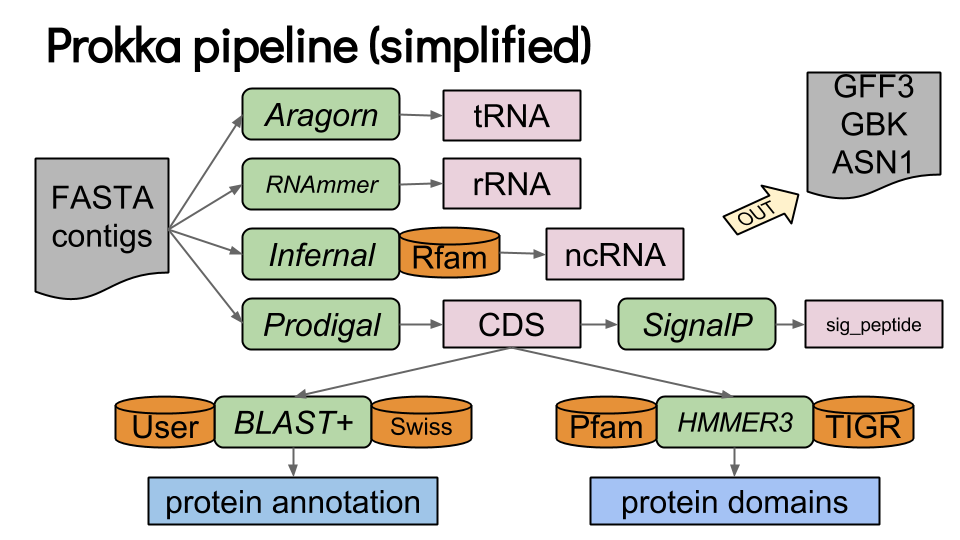
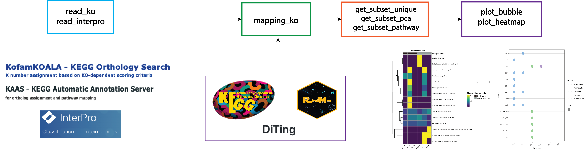
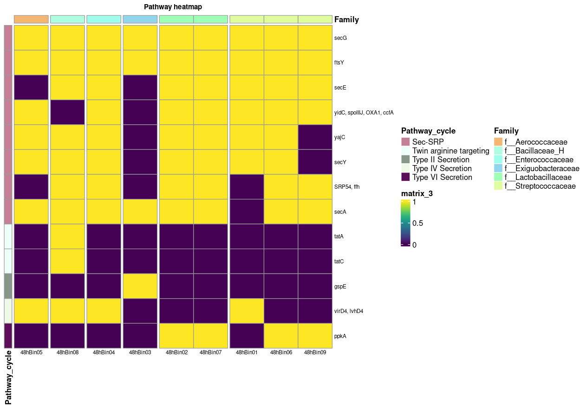

Ahora que ya tenemos los *bins* refinados, queremos saber qué capacidades metabólicas poseen. Para ello es necesario predecir sus genes y asignarles función.

## PROKKA

[Prokka](https://training.galaxyproject.org/training-material/topics/genome-annotation/tutorials/annotation-with-prokka/slides-plain.html) es una herramienta útil, usa diferentes programas para predecir genes, secuencias codificantes, tRNAs, rRNAs. Hace la traducción de CDS a aminoácidos y asigna funciones usando varias bases de datos.

[{fig-align="center" width="460"}](https://training.galaxyproject.org/training-material/topics/genome-annotation/tutorials/annotation-with-prokka/slides-plain.html)

Para correrlo vamos a activar el ambiente en el que se aloja.

::: callout-warning
## Activa el ambiente para PROKKA

``` bash
conda activate mt-prokka
```
:::

Tenemos el ambiente activo, ahora vamos a crear un directorio de resultados para prokka.

``` bash
mkdir -p results/11.prokka/48h
```

Para correrlo, podemos hacer un ciclo que nos permita anotar todos los *bins.*

::: callout-caution
## No lo corras

Este ciclo sólo es un ejemplo de cómo correrlo para todos los bins que tengas y lo podrás usar más adelante en un ejercicio o en los bins o genomas que estés estudiando.

Recuerda ... No lo corras!!!
:::

``` bash
#!/bin/bash
#SBATHC -J prokka
#SBATCH -t 0
#SBATCH -n 6
#SBATCH -N 1
#SBATCH -e outs/11.prokka48.err
#SBATCH -o outs/11.prokka48.out
#SBATCH --export=ALL
#SBATCH -p q2

# 01. Definimos variables de ubicacion de directorios de entrada y de salida
input="results/10.gtdbtk/48h/bins"
out="results/11.prokka/48h"

# 02. Ejecutamos prokka en todos los fasta
for FASTA in $(ls $input/); do
  LOCUSTAG=$(basename $FASTA .fasta)
  prokka --locustag "${LOCUSTAG}_Scaffold" \
  --prefix $LOCUSTAG --addgenes --addmrn \
  --cpus 6 --outdir "${out}/${LOCUSTAG}" \
  "${input}/${FASTA}" ;
done
```

::: callout-tip
## Explora

Para tener una idea de lo que ocurre cuando ejecutas prokka, toma el ejemplo anterior y anota uno de los bins obtenidos en la muestra que le tocó a tu equipo, el que más te guste, procuren elegir bins distintos. Corre prokka con una linea interactiva.
:::

Desactivemos el ambiente:

``` bash
conda deactivate
```

Ahora que tenemos las proteínas predichas vamos a obtener más anotaciones útiles.

------------------------------------------------------------------------

## antiSMASH

Dentro de los genomas microbianos, podemos encontrar algunas regiones específicas que participan en la biosíntesis de metabolitos secundarios, estas secciones se conocen como Clústeres de Genes Biosintéticos, que son relevantes debido a las posibles aplicaciones que pueden tener, por ejemplo: actividades antimicrobianas, antitumorales, reductoras del colesterol, antivirales, etc.

[antiSMASH](https://antismash.secondarymetabolites.org/#!/start) usa modelos ocultos de Markov que permiten identificar los grupos de genes contenidos en las secuencias genómicas que codifican metabolitos secundarios de todas las clases químicas conocidas.

Si te interesa buscar BGCs en los genomas de tu interés puedes aprender siguiendo el flujo de análisis propuestos en la lección de [Minería Genómica](#0) de Software Carpentry.

------------------------------------------------------------------------

## CAZy

[Cazy](https://www.cazy.org/) es una base de datos especializada en enzimas que actúan sobre carbohidratos, esta base de datos se actualiza constantemente y es curada por una comunidad científica que busca dominios funcionales basados en evidencia experimental. Cuentan con [CAZypedia](https://www.cazypedia.org/index.php/Main_Page) para informar especificidades de cada familia cazy.

En el cluster para ejecutar esta búsqueda se encuentra instalado un ambiente de conda que se llama `run_dbcan4`

::: callout-important
## Ejercicio

Crea un script que corra dbcan en el archivo de proteinas que creaste con prokka. Ojo, la ruta y nombre del archivo pues en este ejemplo se corre con las proteinas del bin 48hbin04
:::

``` bash
#!/bin/bash
#SBATHC -J gtdbtk
#SBATCH -t 0
#SBATCH -n 6
#SBATCH -N 1
#SBATCH -e outs/13.cazy48.err
#SBATCH -o outs/13.cazy48.out
#SBATCH --export=ALL
#SBATCH -p q2
#SBATCH --mem 8G

db="/lustre/apps/spack/opt/spack/linux-centos8-ivybridge/gcc-8.3.1/miniconda3-4.7.12.1-ubp7tlghaseisza4pqufq6sbehwa4pog/envs/run_dbcan4/database/db/"

run_dbcan results/11.prokka/48h/48hBin04/48hBin04.faa protein --dia_cpu 6 --hmm_cpu 6 --tf_cpu 6 --stp_cpu 6 --out_pre 48hbin04 --out_dir results/13.cazy/ --db_dir $db --tools all
```

------------------------------------------------------------------------

## KofamScan

[KofamScan](https://github.com/takaram/kofam_scan) es una herramienta de anotación, usa la base de datos KOfam de [KEGG](https://www.genome.jp/kegg/pathway.html) para obtener información sobre los genes que participan en diferentes rutas metabólicas.

Puedes mapear los resultados de kofam en [KEGGMapper](https://www.genome.jp/kegg/mapper/search.html)

Creamos el script para kofam

``` bash
nano src/12.kofam_48h.slurm
```

``` bash
#!/bin/bash
#SBATHC -J kofam
#SBATCH -t 0
#SBATCH -n 6
#SBATCH -N 1
#SBATCH -e outs/12.kofam48h.err
#SBATCH -o outs/12.kofam48h.out
#SBATCH --export=ALL
#SBATCH -p q2
#SBATCH --mem 32G

# 01. Limpiamos por si las moscas :P
module purge

# 02. Cargamos el modulo para kofam
module load kofam-scan/1.3.0/gcc/8.3.1-n3v4

# 03. Creamos el directorio para alojar los resultados
mkdir -p results/12.kofam/48h/

# 04. Lo corremos
for FAA in $(ls results/11.prokka/48h/*/*.faa); do
    name=$(basename $FAA .faa)
    exec_annotation $FAA \
        -o results/12.kofam/48h/"$name.txt" \
        --report-unannotated \
        --cpu 6 \
        --tmp-dir results/12.kofam/48h/"tmp$name" \
        -p /tmp/databases/KOfam/profiles/ \
        -k /tmp/databases/KOfam/ko_list
done

# 05. remover los directorios temporales
rm -r results/12.kofam/48h/tmp*
```

Estos resultados ya los tienes en el directorio `results/12.kofam/48h`

Y ahora que ya tenemos los identificadores de KO para cada proteína, vamos a filtrar y graficar el metabolismo de los *bins*.

### RbiMs

[RbiMs](https://github.com/mirnavazquez/RbiMs) es un paquete de R muy útil para obtener la anotación de cada KEGG ID y generar plots de esta información. Puede trabajar con anotaciones de KOFAM, InterProScan, MEROPS.

{fig-align="center"}

Vamos al editor de Rstudio para correr RbiMs ✨

``` r
#Ubicate en el directorio donde se encuentran los txt de kofam
setwd("/home/alumnoX/")

#A continuación, leemos los resultados de KEGG 
pozol_table <- read_ko(data_kofam = "12.kofam/48h") 

#y los mapeamos con la base de datos de KEGG:
pozol_mapp <- mapping_ko(pozol_table)

#Nos centraremos en las vías metabólicas relacionadas con la biosintesis de aminoacidos y vitaminas:

Overview <- c("Biosynthesis of amino acids", "Vitamin B6 metabolism")
Aminoacids_metabolism_pozol <- pozol_mapp %>%
  drop_na(Module_description) %>%
  get_subset_pathway(Pathway_description, Overview) 

#Visualizamos los datos con un gráfico de burbujas:

plot_bubble(tibble_ko = Aminoacids_metabolism_pozol,
            x_axis = Bin_name, 
            y_axis = Pathway_description,
            analysis = "KEGG",
            calc = "Percentage",
            range_size = c(1, 10),
            y_labs = FALSE,
            x_labs = FALSE)  

#Añadiremos metadatos, como la taxonomía:

Metadatos <- read_delim("results/10.gtdbtk/Metadatos.txt", delim = "\t")

#Y generaremos un gráfico de burbujas con metadatos:

plot_bubble(tibble_ko = Aminoacids_metabolism_pozol,
            x_axis = Bin_name, 
            y_axis = Pathway_description,
            analysis = "KEGG",
            data_experiment = Metadatos,
            calc = "Percentage",
            color_character = Family,
            range_size = c(1, 10),
            y_labs = FALSE,
            x_labs = FALSE) 

# Exploración de una Vía Específica
# podemos explorar una sola vía, como el “Secretion system,” y crear un mapa de calor para visualizar los genes relacionados con esta vía:

Secretion_system_pozol <- pozol_mapp %>%
  drop_na(Cycle) %>%
  get_subset_pathway(Cycle, "Secretion system")

#Y, finalmente, generamos un mapa de calor:

plot_heatmap(tibble_ko = Secretion_system_pozol, 
             y_axis = Genes,
             analysis = "KEGG",
             calc = "Binary")

#También podemos agregar metadatos para obtener una visión más completa:

plot_heatmap(tibble_ko = Secretion_system_pozol, 
             y_axis = Genes,
             data_experiment = Metadatos,
             order_x = Family,
             analysis = "KEGG",
             calc = "Binary")

plot_heatmap(tibble_ko = Secretion_system_pozol, 
             y_axis = Genes,
             data_experiment = Metadatos,
             order_y = Pathway_cycle,
             order_x = Family,
             analysis = "KEGG",
             calc = "Binary")

# Explorar
colnames(pozol_mapp) 

pozol_mapp %>%
  select(Cycle, Pathway_cycle, Pathway_description) %>%
  distinct()
```

{fig-align="center" width="962"}
