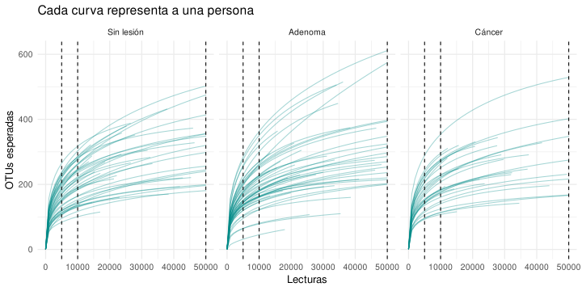
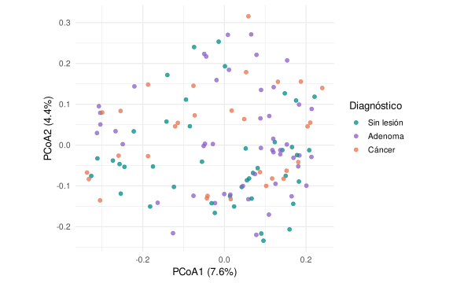
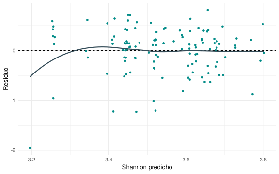
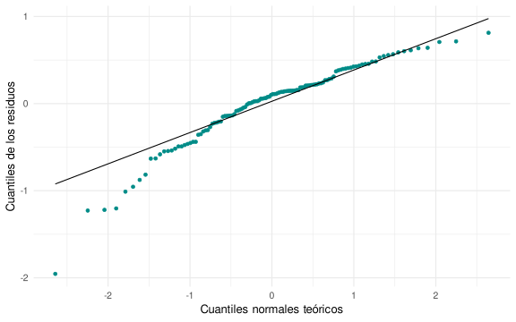
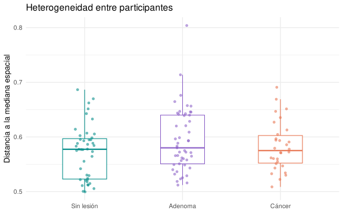

Jueves 12 · 15:00–15:45 y 16:00–17:00 | Viernes 13 · 9:00–10:00 · Noviembre de 2026 · Hora de Ciudad de México.

<div class="estadistica-resumen"><div><strong>122 personas</strong><span>Una muestra fecal por participante</span></div><div><strong>2 preguntas</strong><span>Diversidad y composición</span></div><div><strong>1 recorrido</strong><span>Cargar → comparar → interpretar</span></div></div>


| Sesión · Ciudad de México | Recorrido                                                   |
|---------------------------|-------------------------------------------------------------|
| Jueves · 15:00--15:45     | Secciones 1--3: datos, esfuerzo y diversidad alfa.          |
| Jueves · 16:00--17:00     | Sección 4: distancias y PCoA. Pausa de 15:45 a 16:00.       |
| Viernes · 9:00--10:00     | Secciones 5--7: modelos, dispersión y conclusión ecológica. |

En Colombia, suma una hora. La lista final de otros análisis es material de consulta.

## 1 · Cargar y reconocer los datos {#inicio-r}

Desde tu conexión a **Landalab**, abre en VS Code la carpeta `~/reads2mags_pozol/08_Estadistica_Baxter`. Crea allí `mi_practica.R` para guardar tu código. El único archivo de datos que necesitamos es `datos/practica.rds`; los objetos del análisis se crean durante la práctica.

En **Terminal → New Terminal**, ejecuta esta línea para entrar en la carpeta e iniciar R:

La ruta comienza por `~`, que representa la carpeta personal de la cuenta conectada. Dentro de R usamos rutas relativas a la carpeta de la práctica.

::: {#terminal-inicio .bloque-practica}

**Terminal · Bash**

```bash
cd ~/reads2mags_pozol/08_Estadistica_Baxter && R --vanilla
```

:::

Cuando aparezca `>`, estás en R. Guarda los bloques siguientes en `mi_practica.R` y pégalos, en orden, en esta consola. El símbolo `+` indica que una instrucción sigue abierta: completa el bloque. No copies esos símbolos.

Estudiaremos **122 participantes del estudio de Baxter et al. (2016)**: 43 sin lesión, 49 con adenoma y 30 con cáncer. Cada fila es una persona; cada columna, una OTU de bacterias agrupadas al 97% de similitud. Una OTU no equivale necesariamente a una especie. Las lecturas cuentan detecciones, no personas ni células.

::: {#bloque-01 .bloque-practica}

**R · Bloque 01**

```r
library(vegan)
library(ggplot2)
library(sandwich)
library(lmtest)
dir.create("figuras", showWarnings = FALSE)
dir.create("resultados", showWarnings = FALSE)
datos <- readRDS("datos/practica.rds")
conteos <- datos$conteos
meta <- datos$meta
theme_set(theme_minimal(base_size = 13))
colores <- c("Sin lesión" = "#008B87", "Adenoma" = "#8B5FC7", "Cáncer" = "#E7734F")
dim(conteos)
```

:::

**Debes obtener 122 × 5323.** Si no se encuentra `datos/practica.rds`, ejecuta `getwd()`: la ruta debe terminar en `/reads2mags_pozol/08_Estadistica_Baxter`. Ahora emparejamos cada perfil con su participante y comprobamos los conteos y covariables. `stopifnot()` no imprime nada cuando se cumple la condición.

::: {#bloque-02 .bloque-practica}

**R · Bloque 02**

```r
stopifnot(!anyDuplicated(meta$sample), !anyDuplicated(rownames(conteos)),
          !anyDuplicated(colnames(conteos)), setequal(rownames(conteos), meta$sample))
meta <- meta[match(rownames(conteos), meta$sample), ]
stopifnot(identical(rownames(conteos), meta$sample),
          all(is.finite(conteos)), all(conteos >= 0),
          all(conteos == round(conteos)), all(rowSums(conteos) > 0))
meta$dx <- factor(meta$dx, levels = c("normal", "adenoma", "cancer"))
meta$grupo <- factor(meta$dx, levels = c("normal", "adenoma", "cancer"),
                     labels = c("Sin lesión", "Adenoma", "Cáncer"))
meta$Gender <- factor(meta$Gender)
meta$Site <- factor(meta$Site)
stopifnot(is.numeric(meta$Age),
          all(complete.cases(meta[, c("dx", "Age", "Gender", "Site")])),
          all(table(meta$Site, meta$grupo) > 0))
table(meta$Site, meta$grupo)
```

:::

Los tres diagnósticos están presentes en los cuatro centros, pero no en las mismas proporciones. Ajustaremos por **edad, sexo registrado y centro**. Son grupos observacionales: el ajuste no demuestra causalidad. Un cero en la matriz significa «OTU no detectada»; lo conservamos.

> **Antes de seguir:** ¿por qué el tamaño muestral es 122 y no el número de lecturas?

## 2 · Comparar con el mismo esfuerzo {#esfuerzo}

Una biblioteca con más lecturas tiene más oportunidades de detectar OTUs raras. Necesitamos distinguir **diversidad de la comunidad** de **capacidad de observarla**. Dividir por el total da proporciones, pero no recupera las OTUs que no se detectaron.

Contamos las lecturas y las personas que conservaríamos a cada profundidad. `rarefy()` calcula la riqueza esperada sin extraer lecturas al azar.

::: {#bloque-03 .bloque-practica}

**R · Bloque 03**

```r
lecturas <- rowSums(conteos)
range(lecturas)
data.frame(profundidad = c(5000, 10000, 50000),
           personas = c(sum(lecturas >= 5000), sum(lecturas >= 10000), sum(lecturas >= 50000)))
esperada <- rarefy(conteos, sample = c(5000, 10000, min(lecturas)))
c(ganancia_5000_a_10000 = median(esperada[, 2] - esperada[, 1]),
  ganancia_10000_al_maximo_comun = median(esperada[, 3] - esperada[, 2]))
```

:::

| Profundidad | Personas retenidas | Personas excluidas |
|-------------|--------------------|--------------------|
| 5.000       | 122                | 0                  |
| 10.000      | 122                | 0                  |
| 50.000      | 36                 | 86                 |

La muestra más pequeña tiene **10.661 lecturas**: ese es el máximo común si conservamos a todos. Pasar de 5.000 a 10.000 aporta una mediana de **37,1 OTUs** por persona; subir de 10.000 a 10.661 añade **3,6**.

::: {#bloque-04 .bloque-practica}

**R · Bloque 04**

```r
curvas <- rarecurve(conteos, step = 1000, tidy = TRUE)
curvas$grupo <- meta$grupo[match(curvas$Site, meta$sample)]
p_rarefaccion <- ggplot(subset(curvas, Sample <= 51000), aes(Sample, Species, group = Site)) +
  geom_line(color = "#008B87", alpha = 0.35) +
  geom_vline(xintercept = c(5000, 10000, 50000), linetype = 2) +
  facet_wrap(~ grupo, nrow = 1) +
  coord_cartesian(xlim = c(0, 50000)) +
  labs(x = "Lecturas", y = "OTUs esperadas", title = "Cada curva representa a una persona")
ggsave("figuras/01_rarefaccion.png", p_rarefaccion, width = 10, height = 5, dpi = 150, bg = "white")
```

:::

**Ver el gráfico:** en el explorador de VS Code, abre `figuras/01_rarefaccion.png`. Cada bloque gráfico guarda su propia imagen en `figuras/`; ábrela después de ejecutarlo. `ggsave()` funciona sin una ventana gráfica de R.

{fig-alt="Rarefacción analítica hasta 50.000 lecturas. Las líneas verticales señalan 5.000, 10.000 y 50.000. Las bibliotecas pequeñas terminan antes; no se extrapolan." width=100%}

**Elegimos 10.000:** conserva a las 122 personas y queda cerca del máximo común. También coincide con la profundidad del artículo original. No es un óptimo universal ni significa que hayamos detectado todas las OTUs. Compara las curvas a la misma profundidad, no sus extremos.

`rrarefy()` sí extrae lecturas sin reemplazo y produce la tabla que analizaremos:

::: {#bloque-05 .bloque-practica}

**R · Bloque 05**

```r
set.seed(20261103)
x <- rrarefy(conteos, sample = 10000)
stopifnot(all(rowSums(x) == 10000))
```

:::

Conservamos los conteos iniciales en `conteos`. La semilla reproduce esta extracción, pero no elimina su incertidumbre: aquí usamos una sola rarefacción. Estandarizar el esfuerzo no corrige los sesgos de extracción o PCR.

**Otras preguntas, otros métodos:** Chao1 y ACE estiman riqueza no observada; `iNEXT` permite rarefacción y extrapolación por esfuerzo o cobertura. Son alternativas para estudiar diversidad, no tablas de conteos nuevas ni pasos obligatorios de este análisis.

> **Decisión:** explica por qué 50.000 lecturas no sería simplemente una versión «mejor» de esta comparación.

### ¿Quiénes componen estas comunidades?

La taxonomía ya está en `datos$tax`. Sumamos las OTUs del mismo filo y dividimos por las 10.000 lecturas de cada persona. Mostramos los cinco filos más abundantes en el conjunto; reunimos los restantes en «Otros» y mantenemos «Sin asignar». Esta agrupación es solo para dibujar: los análisis conservan las OTUs.

::: {#bloque-06 .bloque-practica}

**R · Bloque 06**

```r
stopifnot(!anyDuplicated(datos$tax$OTU), setequal(colnames(x), datos$tax$OTU))
taxonomia <- datos$tax$Taxonomy[match(colnames(x), datos$tax$OTU)]
filo <- sub("^[^;]+;([^;(]+).*", "\\1", taxonomia)
filo[filo == "unclassified"] <- "Sin asignar"
filo[!filo %in% c("Firmicutes", "Bacteroidetes", "Actinobacteria",
                  "Verrucomicrobia", "Proteobacteria", "Sin asignar")] <- "Otros"
composicion <- as.data.frame(as.table(rowsum(t(x), filo) / 10000))
names(composicion) <- c("Filo", "sample", "Proporcion")
composicion$grupo <- meta$grupo[match(composicion$sample, meta$sample)]
p_taxonomia <- ggplot(composicion, aes(sample, Proporcion, fill = Filo)) +
  geom_col(width = 1) + facet_grid(~ grupo, scales = "free_x", space = "free_x") +
  scale_y_continuous(labels = scales::label_percent()) + scale_fill_brewer(palette = "Set2") +
  labs(x = "Una barra por participante", y = "Proporción de lecturas", fill = "Filo") +
  guides(fill = guide_legend(nrow = 2)) +
  theme(axis.text.x = element_blank(), axis.ticks.x = element_blank(), legend.position = "bottom")
ggsave("figuras/02_taxonomia.png", p_taxonomia, width = 11, height = 5, dpi = 150, bg = "white")
```

:::

{fig-alt="Composición a 10.000 lecturas, con una barra por persona: 43 sin lesión, 49 con adenoma y 30 con cáncer. Se conservan los nombres taxonómicos del archivo original. Dentro de cada diagnóstico, el orden corresponde al identificador, no a una progresión biológica." width=100%}

Firmicutes y Bacteroidetes concentran gran parte de las lecturas, pero sus proporciones varían entre personas del mismo diagnóstico. Cada filo reúne muchas OTUs: perfiles parecidos a este nivel pueden ocultar diferencias entre ellas. Las barras describen; no demuestran diferencias estadísticas entre diagnósticos.

**Relativa no significa absoluta.** Cada barra suma 100%. Una proporción mayor de Firmicutes puede deberse a más Firmicutes, a menos bacterias de otros grupos o a ambas cosas. No podemos distinguirlo aquí: haría falta una medición independiente de carga bacteriana, por ejemplo mediante citometría o qPCR calibrada. Ni más lecturas ni una proporción mayor equivalen por sí solas a más células por gramo.

## 3 · Diversidad dentro de cada comunidad {#alfa}

**¿Cuántas OTUs detectamos y cómo se reparten sus abundancias?** Una sola cifra no muestra todas las facetas de una comunidad. Los números de Hill permiten compararlas en una unidad común: **OTUs efectivas**, el número de OTUs igualmente abundantes que produciría el mismo valor de diversidad.

| Panel      | Equivalencia                                 | Pregunta ecológica                                                      |
|------------|----------------------------------------------|-------------------------------------------------------------------------|
| q = 0 · D₀ | Riqueza observada: número de OTUs detectadas | ¿Cuántas detectamos? Cada OTU cuenta igual, aunque sea rara.            |
| q = 1 · D₁ | exp(Shannon), con logaritmo natural          | ¿Cuánta diversidad hay al considerar también el reparto de abundancias? |
| q = 2 · D₂ | Inverso de Simpson: 1 / Σpᵢ²                 | ¿Cuánta diversidad queda al dar mayor peso a las OTUs dominantes?       |

`pᵢ` es la proporción de lecturas de cada OTU. Shannon combina riqueza y reparto; D₁ cambia su escala a OTUs efectivas. D₂ pondera más las abundantes. **«Simpson» tiene varias convenciones:** aquí usamos su inverso; Gini-Simpson sería 1 − Σpᵢ². Un valor alto de D₂ indica menor concentración, no mayor dominancia.

::: {#bloque-07 .bloque-practica}

**R · Bloque 07**

```r
alfa <- transform(meta, Riqueza = specnumber(x), Shannon = diversity(x, "shannon"))
alfa$D1 <- exp(alfa$Shannon)
alfa$D2 <- diversity(x, "invsimpson")
aggregate(cbind(Riqueza, Shannon, D1, D2) ~ grupo, alfa, median)
```

:::

::: {#bloque-08 .bloque-practica}

**R · Bloque 08**

```r
diversidad <- stack(alfa[, c("Riqueza", "D1", "D2")])
diversidad$grupo <- rep(alfa$grupo, times = 3)
p_alfa <- ggplot(diversidad, aes(grupo, values, color = grupo)) +
  geom_boxplot(width = 0.45, outlier.shape = NA) +
  geom_point(position = position_jitter(width = 0.10, seed = 8), alpha = 0.55) +
  scale_color_manual(values = colores, guide = "none") +
  facet_wrap(~ ind, scales = "free_y", labeller = as_labeller(c(
    Riqueza = "q = 0: riqueza", D1 = "q = 1: exp(Shannon)", D2 = "q = 2: inverso de Simpson"))) +
  labs(x = NULL, y = "OTUs efectivas", title = "Tres facetas de la diversidad a 10.000 lecturas")
ggsave("figuras/03_diversidad_alfa.png", p_alfa, width = 11, height = 5, dpi = 150, bg = "white")
```

:::

{fig-alt="Cada punto es una persona: sin lesión n = 43, adenoma n = 49, cáncer n = 30. Caja = mediana y Q1–Q3; bigotes hasta observaciones dentro de 1,5 veces el rango intercuartílico. Los paneles tienen distintas escalas verticales: compara los diagnósticos dentro de cada panel." width=100%}

Las medianas de riqueza van de **191 a 214 OTUs**, pero las de D₁ van de **34,6 a 41,4** y las de D₂ de **16,7 a 22,5**. Detectamos muchas OTUs, aunque una parte concentra buena parte de las lecturas. Dentro de una muestra, **D₀ ≥ D₁ ≥ D₂**; coincidirían si todas las OTUs fueran igualmente abundantes.

Estos paneles describen facetas relacionadas, no tres evidencias independientes. No ajustan por covariables ni identifican las OTUs responsables. Una diversidad mayor no equivale automáticamente a mejor salud. El modelo posterior conserva **Shannon = log(D₁)** como respuesta principal.

Estas dos muestras reales permiten separar riqueza de reparto:

::: {#bloque-09 .bloque-practica}

**R · Bloque 09**

```r
ejemplo <- alfa[match(c("2751650", "2667653"), alfa$sample), ]
ejemplo[, c("sample", "grupo", "Riqueza", "Shannon", "D1", "D2")]
```

:::

| Muestra | OTUs detectadas | Shannon | D₁    | D₂    |
|---------|-----------------|---------|-------|-------|
| 2751650 | 180             | 2,931   | 18,75 | 5,80  |
| 2667653 | 180             | 3,873   | 48,08 | 29,60 |

Ambas tienen 180 OTUs, pero la segunda tiene **2,56 veces la diversidad efectiva de orden 1** y un D₂ mucho mayor: sus abundancias están más repartidas. En la primera pesan más unas pocas dominantes. No significa que la segunda tenga 2,56 veces más OTUs. Se eligieron para ilustrar este contraste; no representan por sí solas a sus diagnósticos.

> **Interpreta:** si la riqueza se mantiene pero D₁ y D₂ disminuyen, ¿qué cambió en el reparto de abundancias? ¿Puedes identificar solo con estos índices qué OTU aumentó?

## 4 · De los conteos a una matriz de distancias {#beta}

La diversidad beta pregunta **cuánto difieren las comunidades en identidad y abundancia de OTUs**. Bray--Curtis compara dos filas: suma las diferencias absolutas OTU por OTU y divide entre el total de lecturas de ambas. Repetimos esa operación para todos los pares.

En las muestras 2751650 y 2667653, la suma de diferencias es 13.864. Dividida entre 20.000 lecturas da **0,6932**. Cero significa perfiles idénticos; uno, ninguna OTU detectada en común. No es un porcentaje de especies diferentes.

::: {#bloque-10 .bloque-practica}

**R · Bloque 10**

```r
ids <- c("2751650", "2667653", "2005650")
sum(abs(x[ids[1], ] - x[ids[2], ])) / sum(x[ids[1:2], ])
d_bray <- vegdist(x, method = "bray")
round(as.matrix(d_bray)[ids, ids], 4)
d <- sqrt(d_bray)
```

:::

| Muestra | 2751650 | 2667653 | 2005650 |
|---------|---------|---------|---------|
| 2751650 | 0       | 0,6932  | 0,7280  |
| 2667653 | 0,6932  | 0       | 0,5295  |
| 2005650 | 0,7280  | 0,5295  | 0       |

La matriz completa es de **122 × 122**: diagonal cero y valores simétricos. Las 7.381 parejas no son réplicas independientes, porque comparten personas. Para los análisis siguientes usamos su raíz cuadrada, `d`, que con estos totales iguales permite una geometría euclídea. Conserva el orden de las distancias, pero cambia su escala; usaremos la misma matriz en todos los análisis multivariados.

### ¿Importa quién está o también cuánto hay?

Bray--Curtis considera las abundancias. **Jaccard binario** considera solo OTUs detectadas: una lectura y mil cuentan igual como detección. Comparamos las mismas tres parejas; los ceros compartidos no aumentan su semejanza.

::: {#bloque-11 .bloque-practica}

**R · Bloque 11**

```r
data.frame(par = c("2751650–2667653", "2751650–2005650", "2667653–2005650"),
           Bray_Curtis = as.vector(vegdist(x[ids, ], "bray")),
           Jaccard = as.vector(vegdist(x[ids, ], "jaccard", binary = TRUE)))
```

:::

| Pareja           | Bray--Curtis | Jaccard binario |
|------------------|--------------|-----------------|
| 2751650--2667653 | 0,6932       | 0,5882          |
| 2751650--2005650 | 0,7280       | 0,7143          |
| 2667653--2005650 | 0,5295       | 0,6960          |

Las dos primeras muestras comparten 105 de las 255 OTUs detectadas en al menos una: Jaccard = 1 − 105/255 = **0,5882**. Jaccard responde a diferencias de identidad detectada; Bray--Curtis también responde a cómo se reparten las lecturas. No restes los índices para atribuir una fracción a «recambio»: tienen escalas distintas. Las OTUs raras y su no detección pesan más en Jaccard. Esta comparación es didáctica; mantenemos raíz de Bray--Curtis para la ordenación y las pruebas.

### Una PCoA para explorar

::: {#bloque-12 .bloque-practica}

**R · Bloque 12**

```r
pcoa <- wcmdscale(d, eig = TRUE)
stopifnot(min(pcoa$eig) > -1e-8)
porcentaje <- 100 * pcoa$eig / sum(pcoa$eig)
mapa <- data.frame(meta, Eje1 = pcoa$points[, 1], Eje2 = pcoa$points[, 2])
p_pcoa <- ggplot(mapa, aes(Eje1, Eje2, color = grupo)) +
  geom_point(size = 2, alpha = 0.75) + coord_equal() +
  scale_color_manual(values = colores, name = "Diagnóstico") +
  labs(x = paste0("PCoA1 (", round(porcentaje[1], 1), "%)"),
       y = paste0("PCoA2 (", round(porcentaje[2], 1), "%)"))
ggsave("figuras/04_pcoa.png", p_pcoa, width = 8, height = 5, dpi = 150, bg = "white")
```

:::

{fig-alt="PCoA de raíz de Bray–Curtis. Cada punto es una persona; la cercanía resume semejanza en este plano. Los dos ejes representan solamente el 11,96% de la inercia total." width=100%}

El plano resume una parte pequeña de la información. **El solapamiento no demuestra igualdad y la separación visual no demuestra una asociación.** Los ejes tampoco representan etapas de la enfermedad. La prueba posterior utiliza todas las dimensiones y ajusta las covariables.

> **Interpreta:** ¿podrían dos personas tener el mismo Shannon y comunidades compuestas por OTUs diferentes?

> **Para retomar el viernes:** guarda `mi_practica.R`. Si empiezas una sesión nueva, usa la misma línea de inicio y vuelve a ejecutar los bloques 01--12 desde tu archivo; así reconstruyes los objetos a partir de los datos iniciales. Después continúa con el bloque 13.

## 5 · Contrastar la diversidad y revisar el modelo {#modelo}

Preguntamos si el diagnóstico se asocia con la **media de Shannon**, considerando edad, sexo registrado y centro. No estamos comparando las medianas de las cajas. El modelo supone un efecto lineal de edad y diferencias de diagnóstico constantes entre las covariables.

La prueba de Wald contrasta conjuntamente los dos coeficientes de diagnóstico. Usamos errores robustos HC3 para admitir varianzas residuales distintas; no corrigen dependencia, confusión ni una relación media mal especificada.

::: {#bloque-13 .bloque-practica}

**R · Bloque 13**

```r
options(contrasts = c("contr.treatment", "contr.poly"))
modelo <- lm(Shannon ~ dx + Age + Gender + Site, data = alfa)
stopifnot(modelo$rank == ncol(model.matrix(modelo)))
V <- vcovHC(modelo, type = "HC3")
prueba_alfa <- waldtest(update(modelo, . ~ . - dx), modelo, vcov = V, test = "F")
prueba_alfa
```

:::

Resultado: **F(2, 114) = 2,279; p = 0,107**. Al final corregiremos las dos pruebas principales ---Shannon y composición--- con Holm. La hipótesis nula es que el diagnóstico no aporta diferencias medias de Shannon después del ajuste.

### Magnitud e incertidumbre

::: {#bloque-14 .bloque-practica}

**R · Bloque 14**

```r
terminos <- c("dxadenoma", "dxcancer")
IC <- coefci(modelo, vcov. = V)
efectos <- data.frame(diferencia = coef(modelo)[terminos], IC[terminos, ])
names(efectos) <- c("diferencia", "inferior", "superior")
efectos
```

:::

| Frente a sin lesión | Diferencia de Shannon | IC individual del 95% |
|---------------------|-----------------------|-----------------------|
| Adenoma             | −0,285                | −0,551 a −0,019       |
| Cáncer              | −0,038                | −0,255 a 0,178        |

La estimación de adenoma apunta a menor diversidad, pero **la conclusión principal usa la prueba global ajustada**. Estos intervalos son individuales y describen precisión; no son intervalos simultáneos ni sustituyen esa decisión. No realizaremos una búsqueda de pares significativos.

### Residuos e influencia

Los residuos son observado menos predicho. Buscamos curvatura, cambios de amplitud y observaciones destacadas. En el Q--Q examinamos las colas de los residuos; no exigimos que todas las variables originales sean normales.

::: {#bloque-15 .bloque-practica}

**R · Bloque 15**

```r
diagnostico <- data.frame(sample = alfa$sample, ajustado = fitted(modelo),
                         residuo = resid(modelo), Cook = cooks.distance(modelo))
p_residuos <- ggplot(diagnostico, aes(ajustado, residuo)) +
  geom_hline(yintercept = 0, linetype = 2) + geom_point(color = "#008B87") +
  geom_smooth(method = "loess", se = FALSE, color = "#344C58") +
  labs(x = "Shannon predicho", y = "Residuo")
ggsave("figuras/05_residuos.png", p_residuos, width = 8, height = 5, dpi = 150, bg = "white")
```

:::

{fig-alt="Residuos frente a valores predichos. La línea suavizada ayuda a detectar una forma no representada por el modelo; no constituye otra prueba." width=100%}

::: {#bloque-16 .bloque-practica}

**R · Bloque 16**

```r
p_qq <- ggplot(diagnostico, aes(sample = residuo)) +
  stat_qq(color = "#008B87") + stat_qq_line() +
  labs(x = "Cuantiles normales teóricos", y = "Cuantiles de los residuos")
ggsave("figuras/06_qq.png", p_qq, width = 8, height = 5, dpi = 150, bg = "white")
```

:::

{fig-alt="Q–Q de residuos. Las desviaciones en las colas indican observaciones que merecen examinarse; no activan automáticamente un cambio de prueba." width=100%}

::: {#bloque-17 .bloque-practica}

**R · Bloque 17**

```r
head(diagnostico[order(-diagnostico$Cook), ], 3)
sensibilidad <- update(modelo, data = subset(alfa, sample != "3163690"))
c(completo = coef(modelo)["dxadenoma"],
  sin_3163690 = coef(sensibilidad)["dxadenoma"])
```

:::

La muestra **3163690** tiene la mayor influencia según Cook. Al retirarla solo para esta comprobación, la estimación de adenoma pasa de **−0,285 a −0,215**: parte de la magnitud depende de ella. **El análisis principal conserva las 122 personas**; ser extremo no demuestra un error. HC3 no vuelve irrelevante esta observación.

## 6 · Contrastar composición y dispersión {#composicion}

**PERMANOVA** pregunta si el diagnóstico se asocia con la composición global después del ajuste. Su pseudo-F compara variación atribuible al diagnóstico con variación residual; R² expresa la fracción de variación en esta geometría. Ninguno identifica por sí solo las OTUs que cambian.

::: {#bloque-18 .bloque-practica}

**R · Bloque 18**

```r
control <- permute::how(nperm = 999, blocks = meta$Site)
set.seed(20261103)
permanova <- adonis2(d ~ Age + Gender + Site + dx, data = meta,
                    permutations = control, by = "margin")
permanova[c("dx", "Residual", "Total"), ]
```

:::

`by = "margin"` evalúa diagnóstico considerando los demás términos. Las permutaciones se restringen al centro y requieren intercambiabilidad bajo la hipótesis nula; no convierten este estudio observacional en un experimento. Leemos `dx`, no la p de centro.

Resultado: **pseudo-F(2, 114) = 0,980; R² = 0,0161; p = 0,534**. El diagnóstico aporta marginalmente un **1,61%** de la variación de composición. Es una fracción pequeña en estos datos, no un porcentaje de causas ni exactitud de diagnóstico.

### ¿Los grupos difieren en heterogeneidad?

**PERMDISP** compara las distancias de las personas a la mediana espacial de su diagnóstico. Mayor distancia media significa perfiles más heterogéneos entre personas; no significa mayor diversidad dentro de una persona ni menor estabilidad en el tiempo.

::: {#bloque-19 .bloque-practica}

**R · Bloque 19**

```r
dispersion <- betadisper(d, meta$dx, type = "median", bias.adjust = TRUE)
set.seed(20261103)
prueba_dispersion <- permutest(dispersion, permutations = control)
prueba_dispersion
```

:::

::: {#bloque-20 .bloque-practica}

**R · Bloque 20**

```r
disper <- data.frame(grupo = meta$grupo, distancia = dispersion$distances)
p_dispersion <- ggplot(disper, aes(grupo, distancia, color = grupo)) +
  geom_boxplot(width = 0.45, outlier.shape = NA) +
  geom_point(position = position_jitter(width = 0.10, seed = 8), alpha = 0.55) +
  scale_color_manual(values = colores, guide = "none") +
  labs(x = NULL, y = "Distancia a la mediana espacial", title = "Heterogeneidad entre participantes")
ggsave("figuras/07_dispersion.png", p_dispersion, width = 8, height = 5, dpi = 150, bg = "white")
```

:::

{fig-alt="Distancias en la geometría completa de raíz de Bray–Curtis, con corrección por tamaño de grupo. Puntos y cajas representan participantes y distribución de distancias." width=100%}

**F(2, 119) = 1,847; p = 0,136.** No detectamos dispersión desigual; eso no demuestra igualdad ni valida automáticamente PERMANOVA. El bloqueo por centro no equivale al ajuste por covariables del modelo principal.

Si hubiera dispersión claramente desigual, especialmente con grupos de distinto tamaño, no atribuiríamos una señal de PERMANOVA exclusivamente a diferencias de posición. Este es un diagnóstico complementario, no una tercera hipótesis confirmatoria.

## 7 · Responder la pregunta biológica {#conclusion}

Reunimos las dos pruebas principales y corregimos con Holm. Leemos las p ajustadas, junto con la magnitud y los diagnósticos; no buscamos asteriscos.

::: {#bloque-21 .bloque-practica}

**R · Bloque 21**

```r
globales <- data.frame(pregunta = c("Shannon", "Composición"),
                      p = c(prueba_alfa$`Pr(>F)`[2], permanova["dx", "Pr(>F)"]))
globales$p_Holm <- p.adjust(globales$p, method = "holm")
globales
```

:::

| Pregunta             | p     | p de Holm |
|----------------------|-------|-----------|
| Shannon ajustado     | 0,107 | 0,214     |
| Composición ajustada | 0,534 | 0,534     |

Con el criterio 0,05, ninguna prueba principal rechaza su hipótesis nula. Una p grande no demuestra igualdad ni indica la probabilidad de que la hipótesis nula sea cierta.

La conclusión se mantuvo en una comprobación adicional con 20 semillas a 5.000 y 10.000 lecturas, conservando las mismas personas. Esa estabilidad frente a la extracción aleatoria no elimina los límites del muestreo ni demuestra ausencia de diferencias biológicas.

> **Conclusión ecológica.** En estos 122 participantes encontramos comunidades con abundancias desiguales y variación entre personas. Tras considerar edad, sexo y centro, no obtenemos evidencia suficiente de asociación global del diagnóstico con Shannon o composición. El diagnóstico representa el 1,61% de la variación composicional y no detectamos distinta dispersión. Esto no demuestra equivalencia entre diagnósticos, ausencia de cambios en OTUs concretas ni una trayectoria de deterioro hacia cáncer. Una muestra fecal por persona y perfiles de 16S tampoco permiten identificar causas, funciones metabólicas o abundancias bacterianas absolutas.

El artículo original analizó **490 personas** para predecir lesiones combinando microbiota y hemoglobina fecal. Nuestra pregunta es distinta: estos resultados no reproducen ni refutan su capacidad predictiva.

> **Entrega:** escribe cuatro frases: qué comparaste; por qué usaste 10.000 lecturas; qué indican el R² y las p ajustadas; y qué no permiten concluir estos datos.

Estas líneas guardan la tabla final y las versiones de R y paquetes en resultados/:

::: {#bloque-22 .bloque-practica}

**R · Bloque 22**

```r
write.csv(globales, "resultados/resultados_globales.csv", row.names = FALSE)
capture.output(sessionInfo(), file = "resultados/versiones_R.txt")
```

:::

Tus siete gráficos quedan en `figuras/`; la tabla de contrastes y las versiones de R, en `resultados/`. Guarda también `mi_practica.R` para reproducir el recorrido.

Todos los gráficos de esta página proceden de los bloques visibles. Si reinicias R, ejecuta de nuevo desde el bloque 01. No se necesitan objetos guardados ni scripts auxiliares.

## Para continuar · Otras preguntas y análisis {#otras-preguntas}

El siguiente análisis se elige por la pregunta, no por buscar una p menor. Estas son posibles continuaciones; no añaden tareas ni código a las sesiones programadas.

| Pregunta biológica                                                           | Análisis posible                                                                      | Qué necesitamos o debemos cuidar                                                                                                                                                               |
|------------------------------------------------------------------------------|---------------------------------------------------------------------------------------|------------------------------------------------------------------------------------------------------------------------------------------------------------------------------------------------|
| ¿Qué taxones se asocian con el diagnóstico?                                  | Abundancia diferencial, por ejemplo ANCOM-BC2 o MaAsLin.                              | Conteos iniciales y metadatos: definir filtros, ajustar covariables y corregir múltiples pruebas. Elegir el método por sus supuestos; las barras no son una prueba.                            |
| ¿Cuánta diversidad falta por detectar?                                       | Rarefacción y extrapolación por cobertura con iNEXT; estimación de riqueza con Chao1. | Conteos iniciales. Comparar a cobertura común y mostrar incertidumbre; extrapolar no equivale a observar nuevas OTUs.                                                                          |
| ¿Las diferencias reflejan sustitución de OTUs o pérdida de un subconjunto?   | Partición de diversidad beta con betapart.                                            | Presencia/no detección y esfuerzo comparable. La partición describe el patrón; no demuestra extinción, colonización ni sus causas.                                                             |
| ¿Cómo cambia la comunidad a lo largo de la edad o de un gradiente ambiental? | dbRDA para composición; regresión o GAM para un índice de diversidad.                 | Edad ya disponible; otros gradientes requieren mediciones. Revisar forma de la relación, covariables y dependencia.                                                                            |
| ¿Difieren también los linajes evolutivos?                                    | Diversidad filogenética de Faith y distancias UniFrac.                                | Secuencias representativas y un árbol filogenético adecuado, no incluidos en este paquete. La taxonomía por sí sola no basta.                                                                  |
| ¿Cómo cambia la microbiota de una misma persona con el tiempo?               | Modelos mixtos y análisis longitudinales.                                             | Muestreos repetidos e identificadores de persona. Esta práctica tiene una sola muestra por participante y no responde esa pregunta.                                                            |
| ¿Podemos predecir el diagnóstico de una persona nueva?                       | Clasificación, por ejemplo random forest, con validación cruzada anidada.             | Separar entrenamiento y evaluación por persona y, según el objetivo, por centro; seleccionar variables dentro de cada entrenamiento. Evaluar desempeño fuera del entrenamiento, no causalidad. |
| ¿Qué capacidades metabólicas tiene o expresa la comunidad?                   | Perfiles funcionales y comparación de genes o rutas.                                  | Metagenómica shotgun para potencial genético; metatranscriptómica para expresión. El 16S de esta práctica no mide directamente funciones ni actividad.                                         |

Para cualquier ampliación: define primero la unidad de muestreo, la cantidad que quieres estimar y el alcance de la conclusión. Conserva los conteos iniciales; cada método requiere su propio tratamiento del esfuerzo y de la composición.

## Fuentes y consulta {.unnumbered}

- [Baxter et al. (2016)](https://doi.org/10.1186/s13073-016-0290-3)
- [Rarefacción](https://vegandevs.github.io/vegan/reference/rarefy.html)
- [Índices de diversidad](https://vegandevs.github.io/vegan/reference/diversity.html)
- [Bray–Curtis y Jaccard](https://vegandevs.github.io/vegan/reference/vegdist.html)
- [Composición taxonómica](https://bioconductor.org/books/release/OMA/pages/composition.html)
- [HC3](https://sandwich.r-forge.r-project.org/reference/vcovHC.html)
- [PERMANOVA](https://vegandevs.github.io/vegan/reference/adonis.html)
- [Dispersión](https://vegandevs.github.io/vegan/reference/betadisper.html)
- [iNEXT y cobertura](https://cran.r-project.org/package=iNEXT)
- [Abundancia diferencial](https://bioconductor.org/books/release/OMA/pages/differential_abundance.html)
- [Ordenación y filogenia](https://bioconductor.org/books/release/OMA/pages/community_similarity.html)
- [Predicción y validación](https://bioconductor.org/books/release/OMA/pages/machine_learning.html)
- [Partición de diversidad beta](https://cran.r-project.org/package=betapart)
